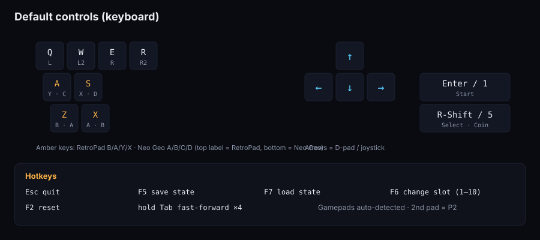
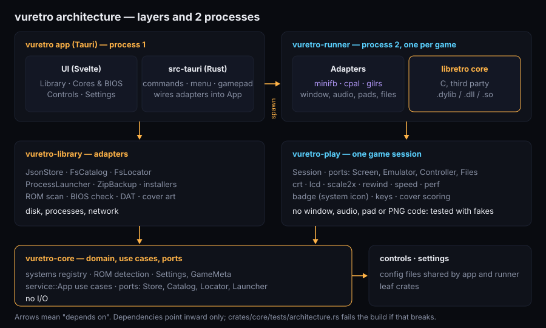

<p align="center"><picture><source media="(prefers-color-scheme: dark)" srcset="docs/assets/brand/logo-horizontal.png"></picture></p>

# vuretro

A cross-platform retro game frontend (macOS, Windows, Linux) that runs games through **libretro cores**.
Supported systems: Neo Geo (FBNeo), PlayStation (PCSX ReARMed), SNES (snes9x) and Game Boy Advance (mGBA). More to come.

> vuretro does **not** ship ROMs or BIOS files. You provide them from copies you own.

## Status

Phase 1 (runner) is in progress. See [docs/PLAN.md](docs/PLAN.md).

| Component | Status |
|---|---|
| `vuretro-runner`: core loading, video, audio, keyboard, gamepad, save states | ✅ working |
| `vuretro-library`: ROM scan, system detection, BIOS check (MD5) | ✅ tested |
| Systems: Neo Geo, PlayStation, **SNES**, **GBA** | ✅ cores load and run |
| Save RAM (`.srm`), core options file, audio rate control | ✅ |
| `vuretro-test-core`: fake core for testing without real ROMs | ✅ |
| Tauri app (Library, Cores & BIOS, Controls) | ✅ first version, see below |

## Quick start

Requires the latest stable Rust (`rustup update`) and Node.js 20+ for the app. Linux also needs:
`sudo apt install libasound2-dev libudev-dev libx11-dev libxkbcommon-dev`.

```bash
make dev                                         # open the app (Library UI)
make demo                                        # runner + fake core, no ROM needed
make cores                                       # download fbneo, pcsx_rearmed, snes9x, mgba into cores/bin/
cp /path/to/neogeo.zip "<data dir>/system/"      # BIOS; the path is printed in the log on start
make play ROM=~/Games/roms/neogeo/mslug.zip      # Neo Geo
make play CORE=pcsx ROM=~/Games/roms/psx/crash.chd SCALE=4
make play CORE=snes ROM=~/Games/roms/snes/zelda.sfc            # SNES
make play CORE=gba  ROM=~/Games/roms/gba/metroid.gba          # Game Boy Advance
make scan ROMS=~/Games/roms                      # scan ROMs + check BIOS
make help                                        # list all commands
```

`make dev` opens the vuretro app. Without a ROM folder it shows a welcome screen with **Try the demo**; `make demo` runs the bare runner with the fake core (color bars, a square you move with the arrow keys, a 440 Hz tone).
More on commands, debugging and CI: [docs/DEVELOPMENT.md](docs/DEVELOPMENT.md).

Default `<data dir>`:
macOS `~/Library/Application Support/dev.vuvn.vuretro`,
Windows `%APPDATA%\vuvn\vuretro\data`,
Linux `~/.local/share/vuretro`.

## The app

How to add games and BIOS, play, remap controls and set up macros: [docs/USAGE.md](docs/USAGE.md).


The screenshot uses sample data. Details and the other screens: [docs/UI.md](docs/UI.md).

## Default controls



| Key | RetroPad | Neo Geo |
|---|---|---|
| Arrow keys | D-pad | Joystick |
| `Z` / `X` / `A` / `S` | B / A / Y / X | A / B / C / D |
| `Enter` or `1` | Start | Start |
| `Right Shift` or `5` | Select | Coin |
| `Q` / `E` / `W` / `R` | L / R / L2 / R2 | |

Hotkeys: `Esc` quit · `F5` save state · `F7` load state · `F6` change slot · hold `Tab` to fast-forward (`F1` to leave it on) · `F2` reset. On a gamepad hold `Select` plus another button. Full list: [docs/USAGE.md](docs/USAGE.md#5-in-the-game-window).
Gamepads (Xbox, DualSense, Switch Pro…) are detected automatically; the second pad is player 2.

## Layout



```
crates/
  libretro-sys/   FFI types from libretro.h (only what is used)
  runner/         vuretro-runner: window, game loop, audio, input
  library/        system registry, ROM scan, BIOS check
  test-core/      fake core: color bars + 440 Hz tone + controllable square
cores/            script that downloads cores from the libretro buildbot
docs/             plan, architecture, UI design, dev guide (+ images/)
Makefile          make dev, play, cores, scan, check, ci …
```

Docs: [CHANGELOG](CHANGELOG.md) · [USAGE](docs/USAGE.md) · [BRAND](docs/assets/brand/README.md) · [DEVELOPMENT](docs/DEVELOPMENT.md) · [ARCHITECTURE](docs/ARCHITECTURE.md) · [UI](docs/UI.md) · [PLAN](docs/PLAN.md)

## License

vuretro source: [MIT](LICENSE). Security reports: see [SECURITY.md](SECURITY.md).
Cores are separate programs loaded at run time and have their own licenses (FBNeo and snes9x: non-commercial, PCSX ReARMed: GPLv2, mGBA: MPL-2.0), see [docs/ARCHITECTURE.md](docs/ARCHITECTURE.md#license).
