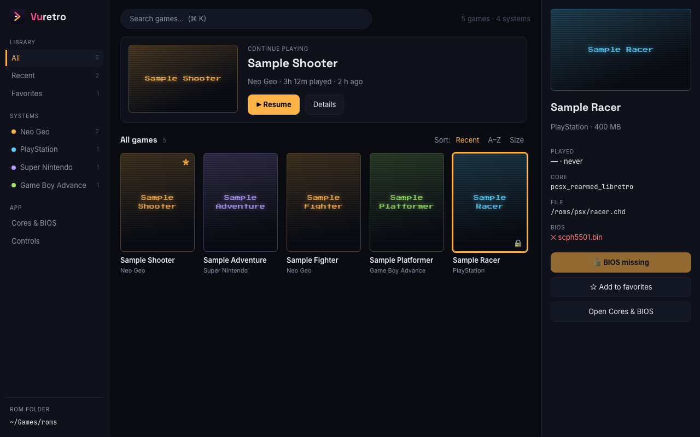
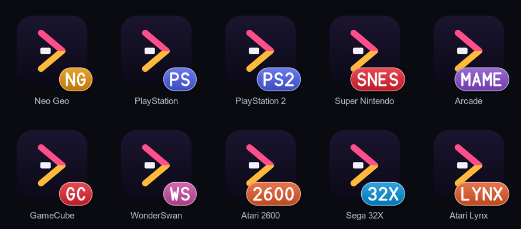

<p align="center"><picture><source media="(prefers-color-scheme: dark)" srcset="docs/assets/brand/logo-horizontal.png"></picture></p>

# vuretro

A cross-platform retro game frontend (macOS, Windows, Linux) that runs games through **libretro cores**.
Supported systems: 26, from Neo Geo (FBNeo), PlayStation (PCSX ReARMed), SNES (snes9x) and Game Boy Advance (mGBA) to Genesis, Game Boy, Atari, arcade (MAME) and the 3D consoles up to PS2 and 3DS. Each game opens in its own window and its Dock icon carries the badge of its system.

> vuretro does **not** ship ROMs or BIOS files. You provide them from copies you own.

## Status

Early releases (0.1.x, unsigned packages). The plan is in [docs/PLAN.md](docs/PLAN.md), what changed in [CHANGELOG.md](CHANGELOG.md).

| Component | Status |
|---|---|
| `vuretro-core`: systems registry, ROM detection, use cases, ports | ✅ tested with fakes |
| `vuretro-play`: the game session (frame loop, hotkeys, save states, rewind, fast-forward, picture filters) | ✅ tested with fakes |
| `vuretro-runner`: window, audio, gamepad and libretro core adapters | ✅ working |
| `vuretro-library`: ROM scan, import, BIOS check (MD5), cores download, backup | ✅ tested |
| Save RAM (`.srm`), core options, audio rate control, per-system and per-game settings | ✅ |
| `vuretro-test-core`: fake core for testing without real ROMs | ✅ |
| Tauri app (Library, Cores & BIOS, Controls, Macros, Cheats, Settings) | ✅ see below |

## Quick start

Requires the latest stable Rust (`rustup update`) and Node.js 20+ for the app. Linux also needs:
`sudo apt install libasound2-dev libudev-dev libx11-dev libxkbcommon-dev`.

```bash
make dev                                         # open the app (Library UI)
make demo                                        # runner + fake core, no ROM needed
make cores                                       # download fbneo, pcsx_rearmed, snes9x, mgba into cores/bin/
                                                 # (the app also downloads the core a game needs when you press Play)
cp /path/to/neogeo.zip "<data dir>/system/"      # BIOS; the path is printed in the log on start
make play ROM=~/Games/roms/neogeo/mslug.zip      # Neo Geo
make play CORE=pcsx ROM=~/Games/roms/psx/crash.chd SCALE=4
make play CORE=snes ROM=~/Games/roms/snes/zelda.sfc            # SNES
make play CORE=gba  ROM=~/Games/roms/gba/metroid.gba          # Game Boy Advance
make scan ROMS=~/Games/roms                      # scan ROMs + check BIOS
make check-bios DIR=~/bios                       # tell what each BIOS file in a folder is
make hooks                                       # git pre-commit: cargo fmt --check
make help                                        # list all commands
```

`make dev` opens the vuretro app. Without a ROM folder it shows a welcome screen with **Try the demo**; `make demo` runs the bare runner with the fake core (color bars, a square you move with the arrow keys, a 440 Hz tone).
More on commands, debugging and CI: [docs/DEVELOPMENT.md](docs/DEVELOPMENT.md).

Default `<data dir>`:
macOS `~/Library/Application Support/dev.vuvn.vuretro`,
Windows `%APPDATA%\vuvn\vuretro\data`,
Linux `~/.local/share/vuretro`.

## The app

How to add games and BIOS, play, remap controls and set up macros: [docs/USAGE.md](docs/USAGE.md). Making fighting-game moves and combos with one key: [docs/MACROS.md](docs/MACROS.md).



The screenshot uses sample data. Details and the other screens: [docs/UI.md](docs/UI.md).

**One badge per system.** A game runs in its own window; on macOS its Dock icon shows the badge of its system, so open games of different systems are told apart at a glance.



<details>
<summary>All 26 systems and their default cores</summary>

| System | Core |
|---|---|
| Neo Geo | fbneo |
| PlayStation | pcsx_rearmed |
| Super Nintendo | snes9x |
| Game Boy Advance | mgba |
| NES / Famicom | fceumm |
| Game Boy | gambatte |
| Game Boy Color | gambatte |
| Genesis / Mega Drive | genesis_plus_gx |
| Master System | genesis_plus_gx |
| Game Gear | genesis_plus_gx |
| PC Engine / TurboGrafx-16 | mednafen_pce_fast |
| Atari 2600 | stella |
| Atari 7800 | prosystem |
| Atari Lynx | handy |
| Neo Geo Pocket | mednafen_ngp |
| WonderSwan | mednafen_wswan |
| Virtual Boy | mednafen_vb |
| Sega 32X | picodrive |
| Nintendo DS | melonds |
| Arcade (MAME) | mame2003_plus |
| Sega Saturn | yabause |

3D systems need a GPU renderer: they stay off until you turn them on, after a check of your computer.

| System | Core |
|---|---|
| Nintendo 64 | mupen64plus_next |
| PlayStation Portable | ppsspp |
| GameCube | dolphin |
| PlayStation 2 | pcsx2 |
| Nintendo 3DS | citra |

</details>

## Default controls


| Key | RetroPad | Neo Geo |
|---|---|---|
| Arrow keys | D-pad | Joystick |
| `Z` / `X` / `A` / `S` | B / A / Y / X | A / B / C / D |
| `Enter` or `1` | Start | Start |
| `Right Shift` or `5` | Select | Coin |
| `Q` / `E` / `W` / `R` | L / R / L2 / R2 | |

Hotkeys: `Esc` quit · `F5` save state · `F7` load state · `F6` change slot · hold `Tab` to fast-forward (`F1` to leave it on) · `F2` reset. On a gamepad hold `Select` plus another button. Full list: [docs/USAGE.md](docs/USAGE.md#5-in-the-game-window).
Gamepads (Xbox, DualSense, Switch Pro…) are detected automatically; the second pad is player 2.

## Layout


```
crates/
  core/           domain, use cases and ports (no I/O): systems, ROM detection, App
  play/           the game session and its pure rules, behind ports (no window or audio code)
  library/        adapters of the ports: disk, processes, network; ROM scan, BIOS check
  runner/         vuretro-runner: minifb window, cpal audio, gilrs pads, libretro core loading
  controls/       key bindings and macros, shared by app and runner
  settings/       game settings, shared by app and runner
  libretro-sys/   FFI types from libretro.h (only what is used)
  test-core/      fake core: color bars + 440 Hz tone + controllable square
src-tauri/        the desktop app shell (Tauri): commands, menu, gamepad
ui/               the app's screens (Svelte)
cores/            scripts that download cores from the libretro buildbot
docs/             plan, architecture, UI design, dev guide (+ images/)
Makefile          make dev, play, cores, scan, check, ci …
```

Dependencies point inward only (`core` knows nothing of the others); a test fails the build if that breaks.

Docs: [CHANGELOG](CHANGELOG.md) · [USAGE](docs/USAGE.md) · [MACROS](docs/MACROS.md) · [BRAND](docs/assets/brand/README.md) · [DEVELOPMENT](docs/DEVELOPMENT.md) · [ARCHITECTURE](docs/ARCHITECTURE.md) · [UI](docs/UI.md) · [PLAN](docs/PLAN.md)

## Support Vuretro

<p align="center">
  Vuretro is free and open source, built and maintained in spare time.<br>
  If it saves you time, you can help keep it going.
</p>

<table align="center">
  <tr>
    <td align="center" width="200"><h2>☕</h2><b>$3</b><br><sub>a cup of coffee</sub></td>
    <td align="center" width="200"><h2>🍜</h2><b>$10</b><br><sub>a lunch</sub></td>
    <td align="center" width="200"><h2>🚀</h2><b>$25</b><br><sub>fuel new features</sub></td>
  </tr>
</table>

<p align="center">
  <a href="https://ko-fi.com/vunguyenvu"></a>
</p>

Other ways to help: [report a bug](https://github.com/vunguyenvu35/vuretro/issues/new/choose), or star the project. In the app, **Help ▸ Support Vuretro…** and **Settings ▸ Help and support** show the same.

## License

vuretro source: [MIT](LICENSE). Security reports: see [SECURITY.md](SECURITY.md).
Cores are separate programs loaded at run time and have their own licenses (FBNeo and snes9x: non-commercial, PCSX ReARMed: GPLv2, mGBA: MPL-2.0), see [docs/ARCHITECTURE.md](docs/ARCHITECTURE.md#license).
