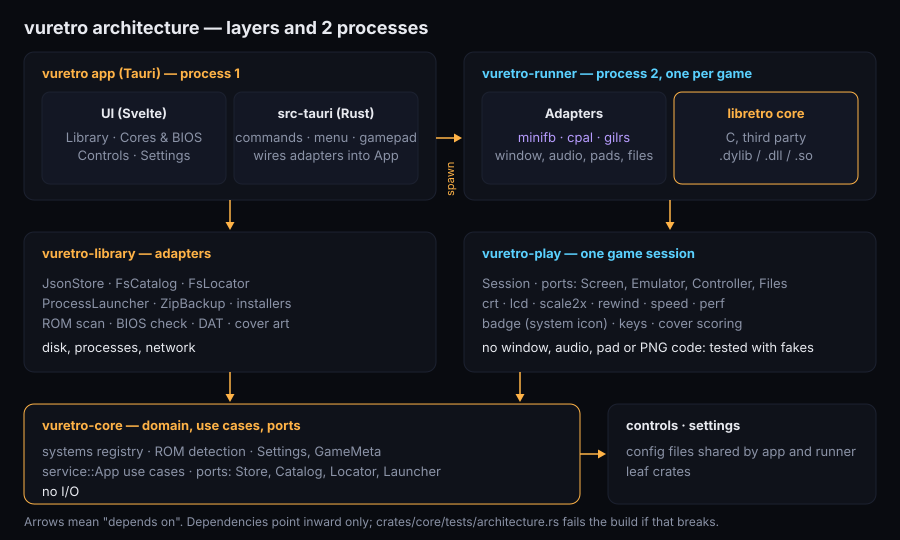
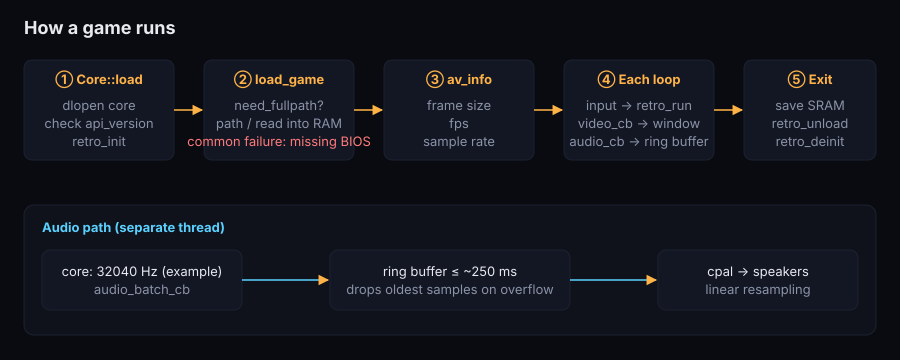

# vuretro architecture

## Overview



The runner is a **separate process**: cores are third-party C code, so if one crashes you only lose the running game and the UI stays alive. The UI and runner talk through command-line arguments (later also JSON on stdout to report play time and save slots).

Try the runner now: `make dev` (see [DEVELOPMENT.md](DEVELOPMENT.md)).

## Layers

Dependencies point inward only; `crates/core/tests/architecture.rs` fails the build if that breaks.

```
src-tauri (Tauri shell: commands, menu, gamepad)      vuretro-runner (window, audio, pads, core loading)
        │                                                   │
        ▼                                                   ▼
vuretro-library (adapters: disk, processes)           vuretro-play (game session, pure rules, ports)
        │                                                   │
        └──────────────►  vuretro-core (domain, use cases, ports)  ◄──┘
                          vuretro-controls / vuretro-settings (shared config files)
```

- **`vuretro-core`**: systems registry, ROM detection by path, `Settings`/`GameMeta`, the "why is this game blocked" rule, and `service::App` with every use case (overview, import, remove, favorites, launch, covers). It reaches the outside only through the traits in `ports.rs` (`Store`, `Catalog`, `Locator`, `Launcher`), so `crates/core/tests/service.rs` tests the use cases with in-memory fakes.
- **`vuretro-library::adapters`**: the real implementations of those ports (`JsonStore`, `FsCatalog`, `FsLocator`, `ProcessLauncher`).
- **`src-tauri`**: `main.rs` only wires adapters into `App`. `commands/` are thin Tauri commands, plus `menu.rs`, `gamepad.rs`, `platform.rs`.
- **`vuretro-play`**: `session.rs` runs the game loop (`Session`) against the traits in `ports.rs` (`Screen`, `Emulator`, `Controller`, `FrameSource`, `Files`), so its tests use fakes. `window.rs` holds the pure rules (actions, title, pacing, pause picture), next to `rewind`, `speed`, `perf`, `rumble`, the picture filters (`crt`, `lcd`, `scale`, `scale2x`), `cover` (which frame makes a good preview), `badge` (the system badge drawn on the Dock icon) and its own `Key` type. It has no window, audio, gamepad, FFI or image-encoding dependency (`play_is_pure` in `architecture.rs`).
- **`vuretro-runner`**: the adapters of `vuretro-play`. `main.rs` loads the core; `screen.rs` (minifb window), `real.rs` (core, gamepad, frames, `open()`), `audio.rs` (cpal), `input.rs` and `padkeys.rs` (keyboard and gilrs), `files.rs` (disk and PNG encoding), `appicon.rs` (Dock icon with the system badge) are the real implementations. `headless.rs` is the windowless mode.
- **UI (`ui/src`)**: `lib/api.js` is the only door to the backend (`lib/mock.js` answers in a browser). `lib/library.js` holds the pure rules of the library screen (filter, sort, summaries; tested with `npm test`). `lib/store.svelte.js` is app state and actions, `lib/ui.svelte.js` the dialog, menu and toasts. Components only render and call these.

## The app

`src-tauri/` (crate `vuretro-app`, binary `vuretro`) exposes commands to the Svelte UI. A watcher thread (gilrs) keeps the connected-pad list and emits `pads-changed` and `pad-button` events for the Controls screen. Games start as `vuretro-runner` child processes: the app waits 1.5 s to catch immediate failures (missing BIOS, bad file) and shows the tail of `logs/runner.log`, then tracks play time until the process exits. It lives in its own Cargo workspace so the core workspace builds without system webview libraries.

## Crates

| Crate | Role |
|---|---|
| `libretro-sys` | FFI types from `libretro.h`, only what is used. Add constants as cores need them. |
| `vuretro-core` | Domain, use cases and ports. No I/O. |
| `vuretro-library` | Adapters for the ports, plus `scan` (walk a folder), `bios` (check and import), `roms` (import and remove). The `vuretro-scan` binary prints JSON. |
| `vuretro-controls` | Controls and macros config shared by runner and app, and the logic that assigns pads to players. |
| `vuretro-settings` | Game settings file shared by runner and app. |
| `vuretro-play` | The game session and its pure rules, behind ports. No window, audio or gamepad code. |
| `vuretro-runner` | Binary that runs one game, the adapters of `vuretro-play`: `core.rs` loads symbols, `frontend.rs` holds the C callbacks, plus `screen.rs`, `audio.rs`, `input.rs`, `options.rs`, `files.rs`, `appicon.rs`. |
| `vuretro-app` (`src-tauri/`) | Tauri shell. Separate workspace. |
| `vuretro-test-core` | Fake core (cdylib) for tests and CI, with fake save RAM and one core option. `make dev` and `make smoke` use it. |

## How a game runs



1. `Core::load`: `dlopen` the core, check `retro_api_version`, register 6 callbacks, call `retro_init`.
2. `load_game`: if the core has `need_fullpath`, pass only the path; otherwise read the file into RAM. A missing BIOS is the usual failure here.
3. `retro_get_system_av_info` → frame size, fps, sample rate.
4. Each iteration: read input → `retro_run` (fast-forward runs it 4 times) → the core calls `video_cb` (pixels converted to `0RGB` u32) and `audio_batch_cb` (pushed into the ring buffer) → draw the window.
5. The `cpal` audio thread pulls samples from the ring buffer and linearly resamples from the core rate to the device rate. **Dynamic rate control** nudges the resampling speed by at most ±0.5 % so the buffer level converges to ~60 ms: video is paced by a timer, audio follows it without crackles or growing latency. The buffer is capped at ~250 ms; on overflow the oldest samples are dropped.
6. Save RAM: after `load_game` the runner copies `<rom>.srm` into `retro_get_memory_data(SAVE_RAM)`; it writes it back every 30 s and on exit.

## Core options

The core announces options with `SET_VARIABLES` (`"Description; a|b|c"`, first value = default). The runner answers `GET_VARIABLE` from `<data dir>/config/<core>.cfg` (`key = value` lines). `--list-options` prints every option as a ready-to-edit template. Newer cores that only use `SET_CORE_OPTIONS_V2` still work through the `SET_VARIABLES` fallback (verified with snes9x and mGBA).

## Callbacks and global state

libretro callbacks carry no user-data pointer, so frontend state lives in `OnceLock<Mutex<Frontend>>`. Rule: **never hold the lock while calling into the core**, because the core calls back and would lock the mutex again.

## Supported environment calls

Answered with data: `GET_CAN_DUPE`, `GET_OVERSCAN`, `SET_PIXEL_FORMAT`, `GET_SYSTEM_DIRECTORY`, `GET_CORE_ASSETS_DIRECTORY`, `GET_SAVE_DIRECTORY`, `GET_VARIABLE` (values from the options file, otherwise the core default), `GET_VARIABLE_UPDATE`, `GET_LOG_INTERFACE`, `GET_RUMBLE_INTERFACE`, `GET_LANGUAGE` (English), `GET_USERNAME`, `GET_INPUT_DEVICE_CAPABILITIES` (joypad), `GET_INPUT_MAX_USERS`, `GET_AUDIO_VIDEO_ENABLE`, `GET_MESSAGE_INTERFACE_VERSION`.

Acted on: `SET_VARIABLES` (recorded for `--list-options`), `SET_VARIABLE` (a core changes one of its own options), `SET_ROTATION` (the picture is turned in `video_cb`, so vertical arcade games stand up), `SHUTDOWN` (the window closes), `SET_MESSAGE` and `SET_MESSAGE_EXT` (written to the log), `SET_DISK_CONTROL_INTERFACE`, `SET_INPUT_DESCRIPTORS`.

Acknowledged, nothing to do: `SET_GEOMETRY` (the size comes with every frame), `SET_PERFORMANCE_LEVEL`, `SET_SUPPORT_NO_GAME`, `SET_CONTROLLER_INFO`, `SET_SUBSYSTEM_INFO`, `SET_MEMORY_MAPS`, `SET_SERIALIZATION_QUIRKS`.

Hardware rendering (`VURETRO_WINDOW=gl` only): `SET_HW_RENDER` is accepted for `OPENGL_CORE` and `OPENGL` contexts when the run has the OpenGL window, and `GET_PREFERRED_HW_RENDER` answers `OPENGL_CORE`. See [Hardware rendering](#hardware-rendering). Refused with a warning in the log: other renderer types (Vulkan, GLES, Direct3D), `SET_HW_SHARED_CONTEXT`, and `SET_SYSTEM_AV_INFO` (the frame rate and sample rate are not changed while playing). Other commands return `false` and are logged at `trace` level (`RUST_LOG=trace make dev`).

The `EXPERIMENTAL` flag (0x10000) is part of the command number and is never stripped: the header has two commands numbered 44 (`SET_SERIALIZATION_QUIRKS`, and `SET_HW_SHARED_CONTEXT` with the flag).

## Hardware rendering

3D cores (N64, PSP, GameCube, PS2, 3DS) draw with OpenGL instead of handing over pixels. `gl_screen.rs` opens a winit window with a glutin OpenGL context of the version the core asked for (`SET_HW_RENDER` comes during `retro_load_game`, before the window), then `hw.rs` makes a framebuffer the size of the core's largest picture and calls the core's `context_reset`. The core draws into it each `retro_run` and passes `RETRO_HW_FRAME_BUFFER_VALID` to the video callback; the picture stays on the graphics card. The video callback only records its size; the session gets a frame with no pixels (`Frame` with an empty buffer) and the window draws the core's framebuffer texture straight to the window (`Screen::present_gpu`), flipped in the shader if the core draws from the bottom, with the CRT or LCD look and whole-number scaling done there too. When the session needs the pixels (a screenshot, the pause picture, Scale2x, a window that cannot do this, a rotated picture) it asks `FrameSource::current`, which reads the picture back at that moment only. On close, and on a window change, `context_destroy` runs while the context is still current.

macOS gives only OpenGL 4.1 core (or a legacy 2.1), so a core that asks for a compatibility context gets a core one there.

## CRT and LCD looks on the GPU

A window can say it draws the looks itself (`Screen::gpu_look`). The OpenGL window does: the session then sends the picture as the game made it and tells the window which look to draw (`Screen::set_look`), and the fragment shader in `gl_screen.rs` darkens the last row (CRT, 150/256) or the last row and column (LCD, 190/256) of every cell of window pixels a picture pixel covers. With whole-number scaling the cell is the largest whole factor that fits the window; otherwise it is the factor the CPU looks used for a picture of that height. The minifb window, and Scale2x with a look, still use the CPU looks in `vuretro-play` (`crt.rs`, `lcd.rs`), which also keep the same levels.

Checks that need a window and a GPU: `vuretro-runner --window-selftest` (colours reach the screen, and the CRT and LCD looks darken the right rows and columns) and `vuretro-runner --hw-selftest <test core> <rom>` (a core draws with OpenGL, the picture reaches the window without being read back and is the right way up, and so is a later read-back).

## System detection during ROM scan


1. A file inside a system-named folder (`roms/neogeo/…`, `roms/psx/…`) → that system.
2. No folder: use the file extension if it belongs to only one system (`.chd` → PS1).
3. Archives (`.zip`, `.7z`) must be in a system folder, since they can hold games for any system.
4. BIOS files (`neogeo.zip`, `scph*.bin`) are excluded from the game list.

Try it: `make scan ROMS=~/Games/roms`.

## Data directory

Resolved with the `directories` crate (`ProjectDirs::from("dev", "vuvn", "vuretro")`):

| OS | Data dir |
|---|---|
| macOS | `~/Library/Application Support/dev.vuvn.vuretro` |
| Windows | `%APPDATA%\vuvn\vuretro\data` |
| Linux | `~/.local/share/vuretro` |

```
<data dir>/
├─ system/   BIOS (neogeo.zip, scph5501.bin, …)
├─ config/   per-core option files (<core>.cfg)
└─ saves/    <rom>.srm, <rom>.state1 … .state4
```

## License

- vuretro source: MIT. Cores are separate libraries loaded at run time, each under its own license; if you ship a core together with vuretro, that core's license applies to it.
- **FBNeo**: non-commercial license → vuretro must be free if it bundles FBNeo.
- **PCSX ReARMed**: GPLv2. **snes9x**: non-commercial. **mGBA**: MPL-2.0.
- DuckStation is not used: its current license does not allow free redistribution.
- ROMs and BIOS: provided by the user; the app neither bundles them nor explains where to download them.
