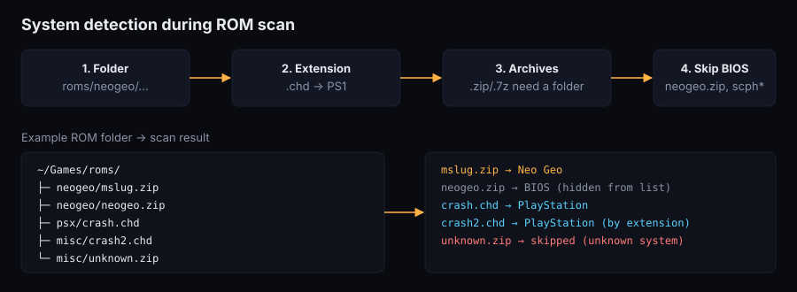

# vuretro architecture

## Overview


The runner is a **separate process**: cores are third-party C code, so if one crashes you only lose the running game and the UI stays alive. The UI and runner talk through command-line arguments (later also JSON on stdout to report play time and save slots).

Try the runner now: `make dev` (see [DEVELOPMENT.md](DEVELOPMENT.md)).

## Crates

| Crate | Role |
|---|---|
| `libretro-sys` | FFI types from `libretro.h`, only what is used. Add constants as cores need them. |
| `vuretro-runner` | Binary that runs one game. `core.rs` loads symbols, `frontend.rs` holds the C callbacks, plus `audio.rs` and `input.rs`. |
| `vuretro-library` | `registry.rs` (system → core, file extensions, BIOS + MD5), `scan.rs`, `bios.rs`. The `vuretro-scan` binary prints JSON. |
| `vuretro-test-core` | Fake core (cdylib) for tests and CI. `make dev` uses it. |

## How a game runs


1. `Core::load`: `dlopen` the core, check `retro_api_version`, register 6 callbacks, call `retro_init`.
2. `load_game`: if the core has `need_fullpath`, pass only the path; otherwise read the file into RAM. A missing BIOS is the usual failure here.
3. `retro_get_system_av_info` → frame size, fps, sample rate.
4. Each iteration: read input → `retro_run` (fast-forward runs it 4 times) → the core calls `video_cb` (pixels converted to `0RGB` u32) and `audio_batch_cb` (pushed into the ring buffer) → draw the window.
5. The `cpal` audio thread pulls samples from the ring buffer and linearly resamples from the core rate to the device rate. The buffer is capped at ~250 ms; on overflow the oldest samples are dropped.

## Callbacks and global state

libretro callbacks carry no user-data pointer, so frontend state lives in `OnceLock<Mutex<Frontend>>`. Rule: **never hold the lock while calling into the core**, because the core calls back and would lock the mutex again.

## Supported environment calls

`GET_CAN_DUPE`, `SET_PIXEL_FORMAT`, `GET_SYSTEM_DIRECTORY`, `GET_CORE_ASSETS_DIRECTORY`, `GET_SAVE_DIRECTORY`, `GET_VARIABLE` (returns defaults), `GET_VARIABLE_UPDATE`, `SET_VARIABLES`, `SET_INPUT_DESCRIPTORS`, `SET_PERFORMANCE_LEVEL`. Other commands return `false` and are logged at `trace` level (`RUST_LOG=trace make dev`).

## System detection during ROM scan



1. A file inside a system-named folder (`roms/neogeo/…`, `roms/psx/…`) → that system.
2. No folder: use the file extension if it belongs to only one system (`.chd` → PS1).
3. Archives (`.zip`, `.7z`) must be in a system folder, since they can hold games for any system.
4. BIOS files (`neogeo.zip`, `scph*.bin`) are excluded from the game list.

Try it: `make scan ROMS=~/Games/roms`.

## Data directory

Resolved with the `directories` crate (`ProjectDirs::from("dev", "vuvn", "vuretro")`):

| OS | Data dir |
|---|---|
| macOS | `~/Library/Application Support/dev.vuvn.vuretro` |
| Windows | `%APPDATA%\vuvn\vuretro\data` |
| Linux | `~/.local/share/vuretro` |

```
<data dir>/
├─ system/   BIOS (neogeo.zip, scph5501.bin, …)
└─ saves/    SRAM, <rom>.state1 … .state4
```

## License

- vuretro source: GPL-3.0-or-later (compatible with GPLv2+ cores when distributed together).
- **FBNeo**: non-commercial license → vuretro must be free if it bundles FBNeo.
- **PCSX ReARMed**: GPLv2. **snes9x**: non-commercial. **mGBA**: MPL-2.0.
- DuckStation is not used: its current license does not allow free redistribution.
- ROMs and BIOS: provided by the user; the app neither bundles them nor explains where to download them.
