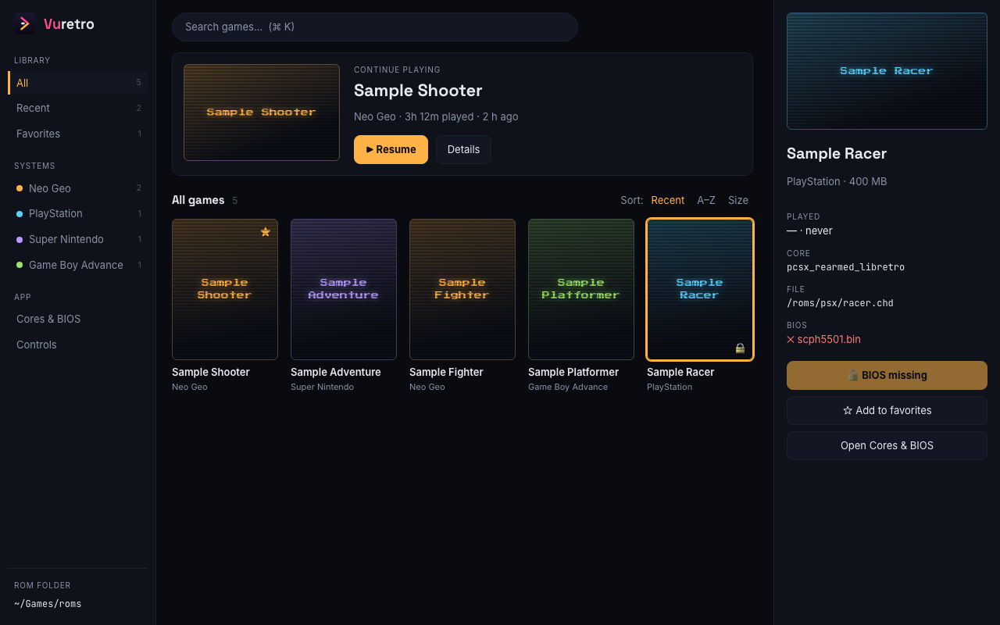

# Development guide

All common commands live in the [Makefile](../Makefile). Run `make` to list them.

## Setup

| OS | Requirements |
|---|---|
| macOS | Stable Rust (`rustup update`), Xcode Command Line Tools |
| Windows | Stable Rust (MSVC toolchain), Git Bash or MSYS2 to run `make` and `fetch-cores.sh` |
| Linux | Stable Rust + `sudo apt install libasound2-dev libudev-dev libx11-dev libxkbcommon-dev` |

## Quick start

```bash
make dev      # the app: Library, Cores & BIOS, Controls
```

The first run compiles the Tauri shell (a few minutes), later runs start in seconds. With no ROM folder yet you see a welcome screen; **Try the demo** launches the fake core so you can check video, audio and input without any ROM.



(Screenshot with sample data.) The app finds `vuretro-runner` and the cores in `target/` and `cores/bin/` of this checkout; installed builds look next to the executable.

## Runner only (no UI, no ROM)

```bash
make demo
```

This builds `vuretro-test-core` and opens the runner with the fake core. You get a 2× window with color bars, a square you can move with the arrow keys, and a 440 Hz tone. Quit with `Esc`.

Change the window size: `make demo SCALE=4`.

Real output of the fake core (`make screenshot`, converted to PNG):


## Play a real game

```bash
make cores                                   # download fbneo + pcsx_rearmed into cores/bin/
cp neogeo.zip "<data dir>/system/"           # your own BIOS; the path is printed in the log on start
make play ROM=~/Games/roms/neogeo/mslug.zip  # Neo Geo (default CORE=fbneo)
make play CORE=pcsx ROM=~/Games/roms/psx/crash.chd SCALE=4
make play CORE=snes ROM=~/Games/roms/snes/zelda.sfc
make play CORE=gba  ROM=~/Games/roms/gba/metroid.gba
```

`<data dir>`: macOS `~/Library/Application Support/dev.vuvn.vuretro`, Windows `%APPDATA%\vuvn\vuretro\data`, Linux `~/.local/share/vuretro`.

Scan a ROM folder (prints JSON with games and BIOS status):

```bash
make scan ROMS=~/Games/roms
```

## Command reference

| Command | What it does |
|---|---|
| `make dev` | Open the app (Library UI); builds the runner and fake core first |
| `make demo` | Run the runner alone with the fake core (no UI, no ROM) |
| `make app-build` | Build the installable app bundle |
| `make play ROM=… [CORE=fbneo\|pcsx] [SCALE=2]` | Run a real game (release build); `CORE=fbneo|pcsx|snes|gba`; `CORE=fbneo|pcsx|snes|gba` |
| `make cores` | Download cores from the libretro buildbot |
| `make options CORE=… ROM=…` | Print a core options template |
| `make smoke` | Fake-core checks: video, save state, SRAM, options |
| `make scan ROMS=…` | Scan ROMs and check BIOS files |
| `make build` / `make release` | Build the whole workspace |
| `make test` | Unit tests |
| `make fmt` | Format code |
| `make lint` | `fmt --check` + `clippy -D warnings` |
| `make check` | `lint` + `test` |
| `make screenshot` | Run 120 headless frames, write `target/shot.ppm` |
| `make ci` | `check` + `smoke`, same as GitHub Actions |
| `make clean` | Remove `target/` |

## Saves and core options

- Save RAM (`<rom>.srm`) is loaded at start, written on exit and every 30 s. Save states: `<rom>.state1..4`. Both live in `<data dir>/saves/`.
- Core options come from `<data dir>/config/<core>.cfg` (for example `mgba_libretro.cfg`), one `key = value` per line. Generate a template with all choices:

```bash
make options CORE=gba ROM=~/Games/roms/gba/metroid.gba > "<data dir>/config/mgba_libretro.cfg"
```

Delete a line to use the core default. Override the file with `--options <FILE>`.

## Supported systems

| System | Core | Folder names | Extensions | BIOS |
|---|---|---|---|---|
| Neo Geo | fbneo | `neogeo`, `mvs`, `aes` | zip, 7z | `neogeo.zip` (required) |
| PlayStation | pcsx_rearmed | `psx`, `ps1` | chd, cue, pbp, m3u, iso, img | `scph5501.bin` (required) |
| SNES | snes9x | `snes`, `sfc` | sfc, smc, swc, fig, zip | none |
| GBA | mgba | `gba` | gba, zip, 7z | `gba_bios.bin` (optional) |

## Where the app keeps things

`<data dir>/settings.json` (ROM folder, switched-off systems), `library.json` (last played, play time, favorites), `logs/runner.log` (output of the last game, shown when a game fails to start), plus `system/`, `saves/`, `config/` as above.

## Debugging
- Port 1420 busy: another Vite project is running; stop it (the app uses a fixed dev port).

- Verbose logs: `RUST_LOG=debug make demo`. To see environment calls the core makes that are not supported yet: `RUST_LOG=trace`.
- Slow or crackling audio: the audio buffer targets 60 ms; check `RUST_LOG=debug` for device rate.
- Core fails to load: check that the file extension matches your OS (`.dylib` / `.dll` / `.so`) and the architecture (arm64 vs x86_64).
- `load_game` error: almost always a missing BIOS. Run `make scan` to see which file is missing.
- No ROM and no display (CI/SSH): use `make screenshot`.

## CI

[`.github/workflows/ci.yml`](../.github/workflows/ci.yml) runs on macOS, Windows and Ubuntu: `fmt`, `clippy`, `test`, then a runner smoke test with the fake core. `make ci` repeats these steps locally.
