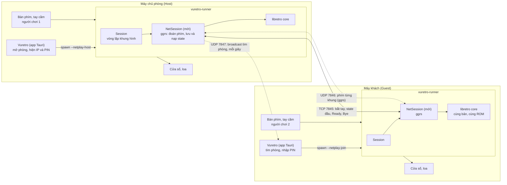
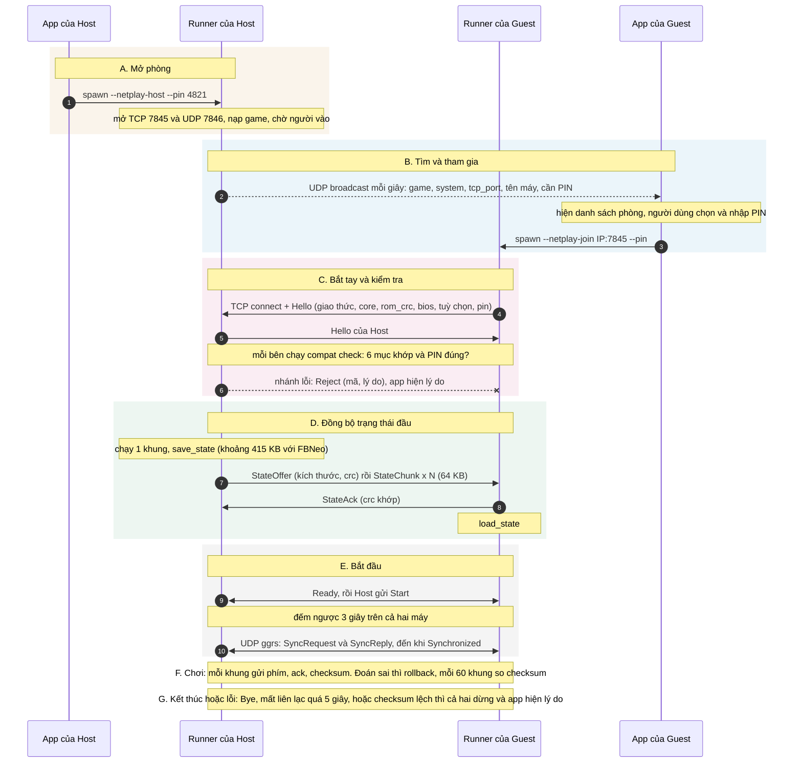
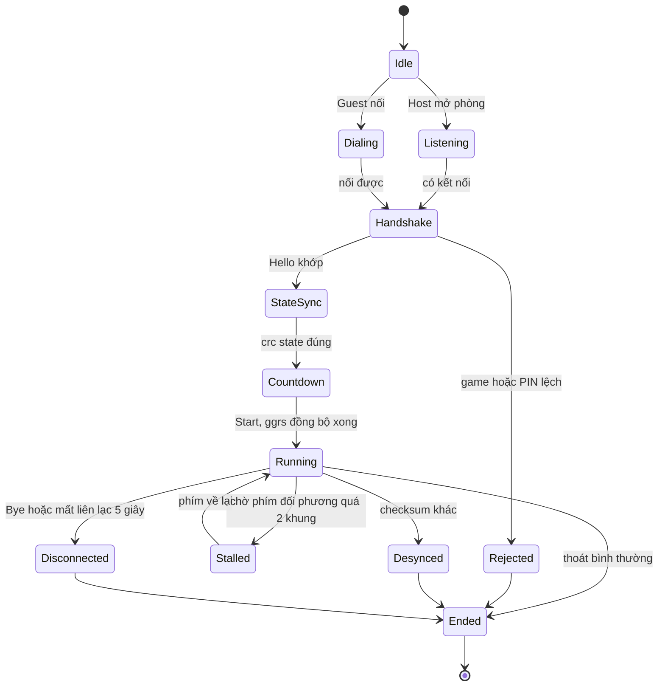
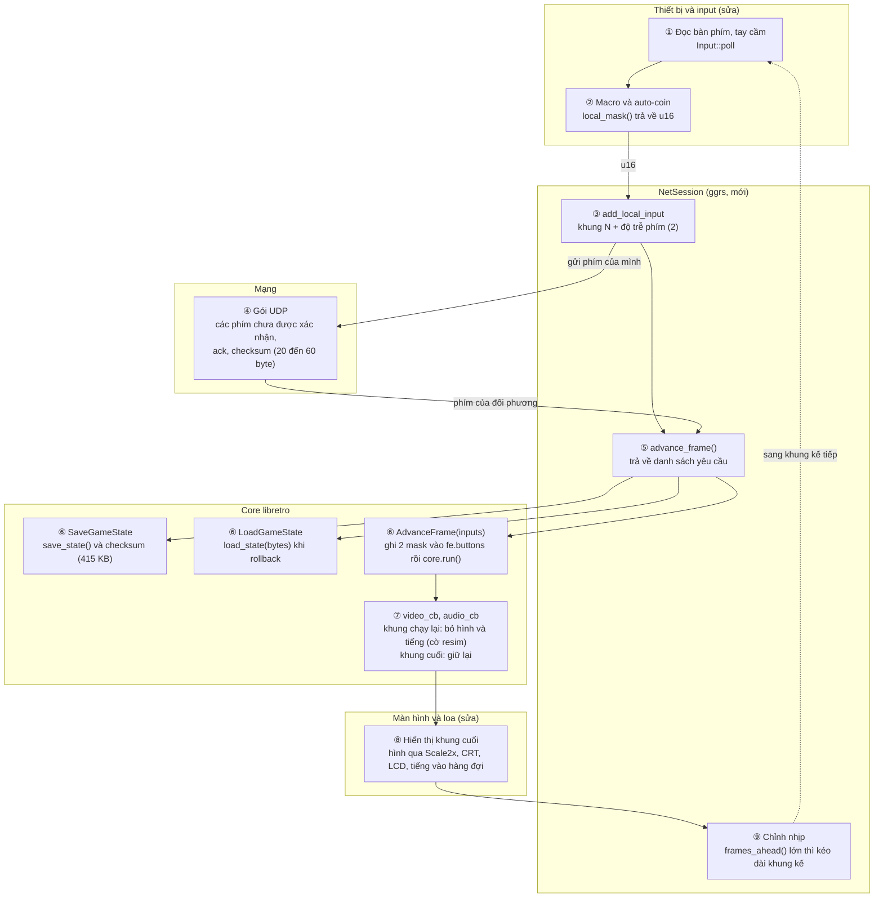
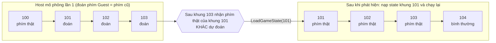
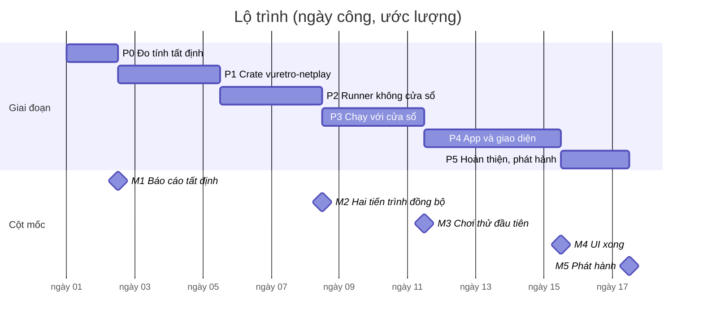
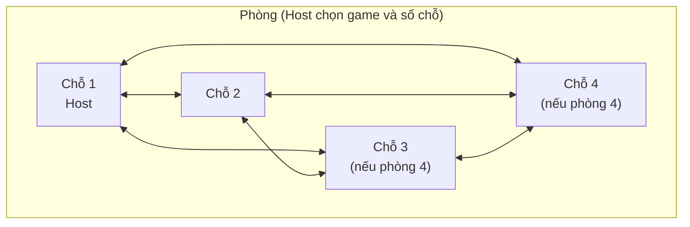
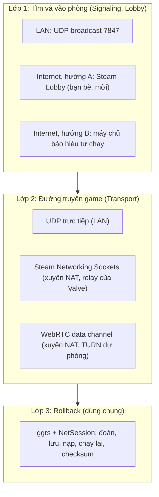

# Kế hoạch: chơi hai máy qua LAN (netplay)

Trạng thái: **kế hoạch, chưa có mã**. Bản có sơ đồ vẽ tay: https://claude.ai/artifact/PJMnQXxrTagH6yeijVCFkW (riêng tư). Các sơ đồ dưới đây dùng Mermaid, GitHub tự vẽ khi xem tệp.

Hai máy trong cùng mạng LAN chơi chung một game, mỗi người một tay cầm hoặc bàn phím. Mỗi máy tự chạy game; chỉ phím bấm đi qua mạng. Khi đoán sai phím của đối phương thì nạp lại trạng thái cũ và chạy lại vài khung hình (rollback).

## Mục lục

1. [Tóm tắt và quyết định](#1-tóm-tắt-và-quyết-định)
2. [Bức tranh tổng thể](#2-bức-tranh-tổng-thể)
3. [Kiến trúc phân lớp](#3-kiến-trúc-phân-lớp)
4. [Luồng kết nối](#4-luồng-kết-nối)
5. [Máy trạng thái của phiên](#5-máy-trạng-thái-của-phiên)
6. [Luồng dữ liệu của một khung hình](#6-luồng-dữ-liệu-của-một-khung-hình)
7. [Rollback](#7-rollback)
8. [Tính tất định](#8-tính-tất-định)
9. [Giao thức](#9-giao-thức)
10. [Chính sách phím tắt khi chơi mạng](#10-chính-sách-phím-tắt-khi-chơi-mạng)
11. [Kế hoạch từng bước](#11-kế-hoạch-từng-bước)
12. [Chiến lược kiểm thử](#12-chiến-lược-kiểm-thử)
13. [Rủi ro](#13-rủi-ro)
14. [Phương án đã cân nhắc](#14-phương-án-đã-cân-nhắc)
15. [Cần quyết định](#15-cần-quyết-định)
16. [Phòng 2 đến 4 máy](#16-phòng-2-đến-4-máy)
17. [Internet và lớp truyền dữ liệu](#17-internet-và-lớp-truyền-dữ-liệu)

## 1. Tóm tắt và quyết định

| | |
|---|---|
| **Cách làm** | Rollback netplay (kiểu GGPO). Hai máy chạy cùng game từ cùng một trạng thái đầu; mỗi khung gửi phím của mình và đoán phím đối phương bằng phím cũ; phím thật đến khác dự đoán thì nạp lại và chạy lại. |
| **Thư viện** | [`ggrs`](https://crates.io/crates/ggrs) 0.13.0 (MIT hoặc Apache-2.0, cập nhật 06/2026). |
| **Dữ liệu qua mạng** | 2 byte mỗi người mỗi khung (16 nút joypad libretro); với 60 khung/giây và gửi lại các phím chưa được xác nhận chỉ vài KB/giây. |
| **Đo trên máy này** | Trạng thái FBNeo (Neo Geo) khoảng 415 KB; core chạy 1174 khung/giây ở bản debug, nên chạy lại 8 khung mất khoảng 7 ms (một khung là 16,7 ms). |
| **Độ trễ phím** | 1 đến 2 khung trên LAN (ping dưới 2 ms), gần như không có rollback. |
| **Mục tiêu dài hạn** | Một **phòng** có 2 đến 4 máy cùng chơi một game, trên LAN và trên Internet (xem [mục 16](#16-phòng-2-đến-4-máy) và [mục 17](#17-internet-và-lớp-truyền-dữ-liệu)). |
| **Phạm vi v1** | Phòng 2 người, LAN, các core 2D mà kiểm tra tính tất định đạt (dự kiến Neo Geo, SNES, NES, Genesis, GBA). Thiết kế đã chừa chỗ cho 4 người và Internet. |
| **Ngoài phạm vi v1** | Internet và xuyên NAT, 3 đến 4 người (làm ở giai đoạn P6, P7), khán giả, vào giữa chừng, hệ 3D và PS1, tạm dừng, tua lại, tua nhanh và nạp state trong lúc chơi mạng. |
| **Ước lượng** | Khoảng 16 ngày công cho một developer (dự đoán, chưa kiểm chứng). |

## 2. Bức tranh tổng thể

Mỗi máy có hai tiến trình: ứng dụng Vuretro (giao diện) và `vuretro-runner` chạy game. Ba đường đi qua mạng, mỗi đường một nhiệm vụ.



Mỗi máy chạy game riêng. Chỉ phím bấm đi qua mạng; hình và tiếng không bao giờ rời máy.

## 3. Kiến trúc phân lớp

Giữ đúng quy tắc của dự án: luật và use case nằm trong `vuretro-core` sau các port, adapter ở `vuretro-library`, giao tiếp mạng và rollback nằm trong một crate mới để kiểm thử độc lập. `vuretro-core` **không** phụ thuộc `ggrs` hay socket (test kiến trúc hiện có giữ nguyên).


Chú giải: xanh là mã mới, cam là mã sửa, nét đứt là bên ngoài.

### Các tệp sẽ thêm hoặc sửa

| Tệp | | Việc làm |
|---|---|---|
| `crates/netplay/src/proto.rs` | mới | Thông điệp điều khiển (Hello, Accept, Reject, StateOffer, StateChunk, StateAck, Ready, Start, Bye), phiên bản giao thức, mã hoá có tiền tố độ dài. |
| `crates/netplay/src/compat.rs` | mới | So hai Hello: giao thức, core, phiên bản core, mã băm ROM, mã băm BIOS, mã băm tuỳ chọn core. Trả về lý do đọc được. |
| `crates/netplay/src/input.rs` | mới | Đổi 16 nút bool sang `u16` và ngược lại; ánh xạ cổng Host = 0, Guest = 1. |
| `crates/netplay/src/driver.rs` | mới | `trait Sim` (save, load, advance) và `RollbackDriver` bọc ggrs P2P và SyncTest; checksum; sự kiện (đồng bộ, lệch, mất kết nối). |
| `crates/netplay/src/discovery.rs` | mới | Mã hoá và giải mã gói "VURETRO-LAN/1", bộ lọc gói lạ. |
| `crates/runner/src/net.rs` | mới | Cầu nối: cài `Sim` cho core, bắt tay TCP, truyền state đầu, điều khiển vòng lặp rollback, tắt hình và tiếng khi chạy lại. |
| `crates/runner/src/session.rs` | sửa | `run_core()` rẽ nhánh sang `net.step()`; bộ lọc hành động bị cấm khi chơi mạng. |
| `crates/runner/src/frontend.rs` | sửa | Cờ `resim`: khi bật thì `audio_batch_cb` bỏ âm thanh và `video_cb` không đổi định dạng hình. |
| `crates/runner/src/input.rs` | sửa | Tách `local_mask()` (sau macro và auto-coin) để gửi đi; nhận mask từ mạng và ghi vào `fe.buttons` trước mỗi lần `run()`. |
| `crates/core/src/{ports,service,model}.rs` | sửa | `LaunchSpec.net`, port `LanDiscovery`, model `NetplayRoom`, use case `host_room`, `find_rooms`, `join_room` có test với bản giả. |
| `crates/library/src/adapters/…` | mới | `UdpLanDiscovery`, liệt kê IP cục bộ, tham số dòng lệnh trong `ProcessLauncher`. |
| `src-tauri/src/commands/lan.rs`, `ui/…/PlayOverLan.svelte` | mới | Bốn lệnh Tauri và hộp thoại Host, Join; thông báo lỗi dễ hiểu. |

## 4. Luồng kết nối

TCP lo mọi thứ cần chắc chắn (bắt tay, state đầu); UDP lo dữ liệu từng khung hình.



App chỉ cần tìm phòng và khởi chạy runner; mọi chuyện mạng còn lại do runner xử lý, nên một lỗi mạng không bao giờ làm sập giao diện.

## 5. Máy trạng thái của phiên



- **Rejected** chỉ xảy ra trước khi chạy game: không bên nào mất dữ liệu.
- **Stalled** không phải lỗi: ggrs giữ máy nhanh chờ máy chậm, hình đứng một nhịp rồi chạy tiếp.
- **Desynced** và **Disconnected** dừng cả hai bên. Không cố "chữa" trạng thái lệch, vì như vậy sẽ che lỗi.
- Người dùng thấy: tiêu đề cửa sổ `LAN · 1 ms · lùi 0/8` (ping, số khung đang rollback); khi Stalled có dòng "chờ đối phương…"; khi kết thúc có hộp thoại kèm lý do và gợi ý (kiểm tra ROM, kiểm tra tường lửa).

## 6. Luồng dữ liệu của một khung hình

Chạy 60 lần mỗi giây trên mỗi máy. Các bước ① đến ⑨ là thứ tự thực hiện.



Khi không có rollback: một lần `AdvanceFrame` mỗi khung. Khi có rollback: một `LoadGameState`, rồi nhiều `AdvanceFrame` liên tiếp; người chơi chỉ thấy khung cuối cùng.

### Vòng lặp, viết ra mã giả

```rust
// NetSession::step(): gọi một lần mỗi khung, thay cho phần chạy core thường
let mask = input.local_mask();                 // ①② phím cục bộ, sau macro và auto-coin (u16)
session.add_local_input(local_handle, mask)?;  // ③ ggrs nhớ phím cho khung N + delay
session.poll_remote_clients();                 // ④ nhận và gửi UDP

for request in session.advance_frame()? {      // ⑤
    match request {
        SaveGameState { cell, frame } => {
            let bytes = emu.save_state()?;     // ⑥ dùng lại bộ đệm, không cấp phát mỗi khung
            cell.save(frame, Some(bytes), Some(checksum(&bytes)));
        }
        LoadGameState { cell, .. } => {
            fe.resim = true;                   // bắt đầu mô phỏng lại: tắt hình, tắt tiếng
            emu.load_state(&cell.load())?;
        }
        AdvanceFrame { inputs } => {
            fe.buttons = to_buttons(inputs);   // [u16; 2] thành bool[2][16], cổng 0 và 1
            emu.run();                         // ⑦ video_cb, audio_cb chạy bên trong
        }
    }
}
fe.resim = false;
present_last_frame_and_audio();                // ⑧
pace(frames_ahead_adjusted_frame_time());      // ⑨
```

## 7. Rollback

Ví dụ: Guest bấm nút ở khung 101 nhưng gói tin đến Host trễ vài khung.



- Ba khung chạy lại trong cùng một nhịp 16,7 ms, tốn khoảng 3 × 0,9 ms.
- Khung 101 đến 103 đã hiển thị theo dự đoán, không bị vẽ lại; sai lệch (nhân vật chưa nhảy ngay) được sửa ở khung 104.
- Dự đoán tối đa 8 khung; quá giới hạn này ggrs dừng máy nhanh (Stalled). Trên LAN gần như không bao giờ chạm tới.
- Độ trễ phím 1 đến 2 khung giúp phần lớn phím của đối phương đến kịp, nên không phải rollback. Cho phép chỉnh trong cài đặt.
- Chi phí: 60 lần lưu mỗi giây với state 415 KB là khoảng 25 MB/giây sao chép bộ nhớ, nhẹ. PS1 (khoảng 4 MB) nặng gấp 10 lần, chưa đưa vào v1.

## 8. Tính tất định

Rollback chỉ đúng khi cùng trạng thái đầu và cùng phím thì luôn ra cùng kết quả trên cả hai máy. Đây là rủi ro lớn nhất của dự án, nên bước đầu tiên là **đo**, không phải phỏng đoán.

Hai máy phải giống nhau về:

1. Bản core (mã băm tệp thư viện) và phiên bản.
2. ROM (CRC32 và kích thước).
3. BIOS dùng chung, ví dụ `neogeo.zip` (mã băm).
4. Tuỳ chọn core ảnh hưởng mô phỏng, ví dụ `fbneo-neogeo-mode` (mã băm tập tuỳ chọn).
5. Trạng thái đầu: Host gửi state ở khung 0 để cả SRAM, đồng hồ thời gian thực và bộ sinh số ngẫu nhiên của game giống nhau.
6. Không có cheat, không tua nhanh, không nạp state trong lúc chơi.

**Công cụ đo ở bước P0**: `vuretro-runner --determinism-check` chạy một game với chuỗi phím giả cố định (bộ sinh số có hạt giống), qua hai kiểm tra:

- **Nạp lại:** lưu state ở khung k, chạy tới khung 600, nạp lại state, chạy lại. Hai lần phải cho cùng mã băm hình, tiếng và state ở mọi khung.
- **Hai tiến trình:** chạy hai tiến trình độc lập từ cùng điều kiện đầu, so mã băm ở mỗi khung.

Kết quả là bảng "core × ROM: đạt hoặc lệch". Chỉ cặp đạt mới được bật netplay.

| Hệ máy, core | Dự đoán ban đầu | Lý do và điều cần kiểm tra |
|---|---|---|
| Neo Geo, arcade: FBNeo | Phù hợp | State đầy đủ (415 KB đã đo). Cần kiểm tra chế độ BIOS và các DIP switch phải giống nhau. |
| SNES: snes9x | Phù hợp | Core cổ điển, tất định. Cẩn thận với tuỳ chọn tăng tốc như bỏ giới hạn sprite. |
| NES: fceumm; Genesis, SMS: Genesis Plus GX; PC Engine | Phù hợp | Nhẹ, state nhỏ. Kiểm tra bằng công cụ P0 cho từng core. |
| Game Boy Advance: mGBA | Cần kiểm tra | Một số game đọc đồng hồ thật (RTC): phải truyền trong state đầu hoặc cố định thời gian. Cáp link chưa mô phỏng. |
| PlayStation: PCSX ReARMed | Để sau | State khoảng 4 MB, lưu mỗi khung tốn gấp 10 lần. Cần đo trước khi quyết định. |
| Arcade: MAME 2003-Plus, MAME mới | Cần kiểm tra | Một số game dùng nhiều luồng hoặc bộ đếm thời gian thực. |
| Hệ 3D (N64, PSP, GameCube, PS2, 3DS) | Không | Core đa luồng, dựng hình bằng GPU, state rất lớn. Ngoài phạm vi. |

## 9. Giao thức

Điều khiển bằng TCP (tin cậy, có thứ tự), dữ liệu từng khung bằng UDP của ggrs. Thông điệp điều khiển nhỏ nên dùng JSON có tiền tố độ dài (dễ gỡ lỗi); riêng state đầu dùng khối nhị phân.

| Cổng | Giao thức | Nội dung | Bên gửi |
|---|---|---|---|
| `7845` | TCP | Thông điệp điều khiển, state đầu | cả hai |
| `7846` | UDP | Gói của ggrs: phím, ack, checksum, đồng bộ | cả hai |
| `7847` | UDP broadcast | Thông báo phòng "VURETRO-LAN/1" | Host, mỗi giây |

| Thông điệp (TCP) | Trường chính | Mục đích |
|---|---|---|
| `Hello` | `proto`, `app`, `core`, `core_hash`, `rom_crc`, `rom_size`, `bios_hash`, `options_hash`, `fps`, `pin` | Mỗi bên khai báo cấu hình để so sánh. |
| `Accept`, `Reject` | `code`, `reason` (tiếng người đọc được) | Kết quả so sánh; lý do hiện thẳng cho người dùng. |
| `StateOffer` | `size`, `crc32`, `chunks` | Host báo trước kích thước state đầu. |
| `StateChunk` | `seq`, bytes (64 KB) | Chuyển state theo từng khối, có thể báo tiến độ. |
| `StateAck` | `crc_ok` | Guest xác nhận đã nạp đúng. |
| `Ready`, `Start` | `countdown_ms` | Cả hai sẵn sàng thì Host cho chạy; ggrs tự đồng bộ nhịp ở pha UDP. |
| `Bye` | `reason` | Thoát có chủ ý, để bên kia hiện lời nhắn đúng. |

**Bảo mật cho một cổng mở trong LAN**

- PIN 4 chữ số trong Hello; nhận đúng một người chơi, các kết nối sau bị đóng.
- Mọi gói có giới hạn kích thước; thông điệp không nhận ra bị bỏ.
- Không bao giờ chạy mã hay mở tệp từ gói tin; chỉ đọc dữ liệu có cấu trúc cố định.
- Có thể tắt phát hiện phòng và dùng IP nhập tay.

**Thực tế trên từng hệ điều hành**

- Windows và macOS có thể hỏi quyền tường lửa cho lần đầu mở cổng.
- macOS 15 trở lên hỏi quyền "Mạng cục bộ" khi ứng dụng nghe broadcast.
- Một số Wi-Fi cô lập từng thiết bị: broadcast không tới được, nên luôn có ô nhập IP.

## 10. Chính sách phím tắt khi chơi mạng

Quy tắc: thứ gì thay đổi mô phỏng thì bị cấm; thứ chỉ thay đổi cách hiển thị trên máy mình thì được giữ.

| Tính năng | Khi chơi mạng | Lý do |
|---|---|---|
| Tạm dừng, tua nhanh, chuyển động chậm | Tắt | Đổi nhịp mô phỏng của một máy, hai bên lệch ngay. |
| Rewind, nạp state, tiếp tục chỗ đang dừng | Tắt | Đưa trạng thái về quá khứ chỉ ở một máy. |
| Cheat, đổi đĩa, reset | Tắt ở v1 | Thay đổi bộ nhớ; có thể làm sau bằng "yêu cầu cả hai bên". |
| Lưu state (F5) | Được | Chỉ ghi ra tệp, không đổi mô phỏng. |
| Chụp màn hình, tắt tiếng, đổi cỡ cửa sổ, toàn màn hình | Được | Chỉ ở phía hiển thị của máy mình. |
| CRT, LCD, Scale2x | Được | Hiệu ứng áp lên hình đã vẽ, không đụng tới core. |
| Macro và auto-coin | Được | Chạy trước khi tạo mask gửi đi, nên đối phương nhận kết quả cuối cùng. |
| Thoát game | Kết thúc phiên | Bên kia nhận Bye và thấy lý do. |

Auto-coin đếm theo số lần poll, mỗi khung một lần, và poll chỉ xảy ra một lần cho mỗi khung thật (không lặp khi rollback), nên nó vẫn tất định.

## 11. Kế hoạch từng bước

Sáu giai đoạn, mỗi giai đoạn có sản phẩm kiểm tra được và tiêu chí hoàn thành. Làm tuần tự. Số ngày là ước lượng cho một developer.



### P0. Đo tính tất định (1,5 ngày)

Giải quyết rủi ro: core không tất định.

- Thêm cờ `--determinism-check` cho runner: chạy headless, chuỗi phím giả dùng bộ sinh số cố định, ghi mã băm hình, tiếng và state mỗi khung.
- Hai chế độ: nạp lại state rồi chạy lại; chạy trong hai tiến trình khác nhau.
- Chạy trên các ROM thật có sẵn cho FBNeo, snes9x, mGBA, Genesis Plus GX, fceumm.

**Xong khi:** có bảng "core × ROM: đạt hoặc lệch", danh sách hệ được phép bật netplay cho v1 đã chốt, và test-core của dự án đạt 100% (làm thành bài kiểm tra tự động trong CI).

### P1. Crate `vuretro-netplay` (3 ngày, sau P0)

- Crate thuần (không I/O trực tiếp): `proto`, `compat`, `input`, `discovery` codec.
- `trait Sim` và `RollbackDriver` bọc ggrs; dùng **SyncTestSession** của ggrs để ép rollback mỗi khung trên một "mô phỏng giả" và so checksum.
- Bộ đệm lưu state dùng lại, không cấp phát mỗi khung.

**Xong khi:** test đơn vị cho mọi thông điệp và mọi nhánh compat; SyncTest 10 000 khung với mô phỏng giả không lệch; fuzz bộ giải mã gói không panic.

### P2. Runner chạy được không cửa sổ (3 ngày, sau P1)

- Cờ `--netplay-host`, `--netplay-join`, `--pin`, `--net-delay`.
- Bắt tay TCP, chuyển state đầu, ggrs qua UDP thật, cờ `resim` trong frontend.
- Bọc socket để chèn mất gói, trễ, đảo thứ tự trong test.

**Xong khi:** test tự động chạy hai tiến trình runner trên localhost với test-core, 3000 khung, mã băm state cuối của hai bên bằng nhau, trên cả ba hệ điều hành trong CI; vẫn đạt khi mất 10% gói và trễ ngẫu nhiên 0 đến 40 ms.

### P3. Chạy với cửa sổ (3 ngày, sau P2)

- Móc vào `Session::run_core`: nhịp theo `frames_ahead()`, chỉ hiển thị khung cuối, tắt tiếng khi chạy lại.
- Bộ lọc phím tắt theo bảng chính sách; hiển thị ping và số khung rollback trong tiêu đề.
- Xử lý rút tay cầm, đóng cửa sổ, mất mạng, Stalled.

**Xong khi:** hai máy thật chơi Neo Geo qua LAN 10 phút không lệch; không có tiếng lạ khi rollback; thử đủ macOS, Windows, Linux.

### P4. App và giao diện (4 ngày, sau P3)

- Lõi: model `NetplayRoom`, port `LanDiscovery`, use case `host_room`, `find_rooms`, `join_room` có test với bản giả.
- Adapter UDP broadcast, liệt kê IP; lệnh Tauri; hộp thoại Host (hiện IP và PIN) và Join (danh sách phòng và ô nhập IP).
- Lỗi dễ hiểu (ROM khác, PIN sai, tường lửa); mục trong menu Help và nút ở chi tiết game; tài liệu USAGE.

**Xong khi:** hai người không đọc tài liệu vẫn vào được phòng trong dưới một phút; mọi thông báo lỗi có hướng xử lý.

### P5. Hoàn thiện và phát hành (2 ngày, sau P4)

- Thử trên Wi-Fi và Ethernet; chỉnh độ trễ phím mặc định theo số đo.
- Chế độ ghi state khi lệch (`--net-dump-on-desync`) để điều tra lỗi từ người dùng.
- Ghi vào CHANGELOG và USAGE, thêm mục "Chơi qua LAN" vào hướng dẫn, phát hành.

**Xong khi:** danh sách hệ được hỗ trợ được ghi rõ; có hướng dẫn xử lý sự cố; bản phát hành có ghi chú giới hạn.

## 12. Chiến lược kiểm thử

Từ rẻ tới đắt:

1. **Đơn vị:** mã hoá thông điệp, so sánh compat, ánh xạ phím, gói broadcast (chạy trong mili-giây).
2. **SyncTest:** ép rollback mỗi khung, mọi checksum phải khớp (bắt lỗi lưu và nạp state).
3. **Hai tiến trình trên localhost:** test-core, so mã băm state cuối, chạy trong CI trên 3 hệ điều hành.
4. **Chèn lỗi mạng:** mất gói 0, 5, 10, 20%; trễ 0 đến 40 ms; đảo thứ tự.
5. **Ma trận core thật:** các core và ROM đã qua P0, chạy ban đêm hoặc thủ công.
6. **Thủ công trên LAN thật:** danh sách kiểm tra cho Wi-Fi, Ethernet, tường lửa.

Những lỗi phải có test chặn:

- Lệch đồng bộ không được che giấu: phải dừng và báo.
- Phím macro hoặc auto-coin không được gửi hai lần khi rollback.
- Tiếng và hình của khung chạy lại không được lọt ra ngoài.
- Gói lạ hoặc quá lớn không làm runner sập.
- Test kiến trúc: `vuretro-core` không phụ thuộc ggrs hay socket.

## 13. Rủi ro

| Rủi ro | Mức | Giảm thiểu |
|---|---|---|
| Core không tất định (đồng hồ thật, đa luồng) làm hai máy lệch dần | Cao | P0 đo trước; chỉ bật netplay cho cặp core và ROM đã đạt; truyền state đầu; checksum định kỳ để dừng ngay khi lệch. |
| Wi-Fi giật làm rollback dài | Vừa | Độ trễ phím 2 đến 3 khung, dự đoán tối đa 8, hiển thị ping; khuyên dùng Ethernet cho game đối kháng. |
| Tường lửa, quyền Mạng cục bộ, Wi-Fi cô lập thiết bị | Vừa | Thông báo rõ nguyên nhân và cách mở; luôn có ô nhập IP tay. |
| Âm thanh vỡ khi rollback | Vừa | Cờ `resim` bỏ tiếng của khung chạy lại; chỉ đẩy tiếng của khung cuối. |
| State lớn (PS1) làm tốn CPU | Vừa | Danh sách cho phép; đo ở P0; bộ đệm tái sử dụng. |
| Hai máy khác phiên bản core hoặc tuỳ chọn mà không biết | Vừa | Mã băm trong Hello, Reject kèm lý do đọc được. |
| Một cổng mở trong LAN bị người khác chen vào | Vừa | PIN, nhận một người, giới hạn kích thước gói. |
| Phụ thuộc `ggrs` (bảo trì bên ngoài) | Thấp | Bọc sau `RollbackDriver`; giấy phép MIT hoặc Apache-2.0; có bản cập nhật 06/2026. |

## 14. Phương án đã cân nhắc

| Phương án | Ưu | Nhược | Kết luận |
|---|---|---|---|
| **Rollback bằng ggrs** | Cảm giác gần như chơi tại chỗ; thư viện đã được kiểm chứng; tận dụng sẵn lưu và nạp state | Cần core tất định; phải làm công cụ đo | **Chọn** |
| Lockstep có độ trễ cố định | Đơn giản, dễ hiểu | Độ trễ bằng cả ping; một gói chậm là đứng hình | Dự phòng nếu ggrs gặp vấn đề |
| Truyền hình (Parsec, Moonlight, Steam Remote Play) | Không cần viết mã; chạy được cả hệ 3D | Thêm 10 đến 30 ms; không tích hợp trong app | Cách dùng ngay hôm nay |
| Tự viết rollback từ đầu | Toàn quyền | Nhiều tuần, dễ lỗi tinh vi; không hơn ggrs | Loại |
| Tương thích giao thức netplay của RetroArch | Chơi chung với người dùng RetroArch | Phải khớp từng phiên bản core và giao thức; công việc lớn | Loại ở v1 |
| WebRTC (matchbox) cho Internet | Xuyên NAT, không cần mở cổng | Cần máy chủ báo hiệu để vận hành | Giai đoạn sau, trên cùng `RollbackDriver` |

## 15. Cần quyết định

1. **Bắt đầu từ P0?** P0 mất 1,5 ngày và cho biết ngay core nào dùng được. Đề nghị làm trước, rồi mới cam kết các giai đoạn sau.
2. **PIN mặc định?** Đề nghị bật PIN 4 số mặc định, cho phép tắt trong cài đặt (LAN gia đình hay quán thường có người lạ).
3. **Phạm vi người chơi.** Mục tiêu là phòng 2 hoặc 4 máy ([mục 16](#16-phòng-2-đến-4-máy)). Đề nghị v1 làm hai người nhưng viết mã theo số người tuỳ ý ngay từ đầu, để bốn người chỉ còn là kiểm thử và giao diện.
4. **Internet.** Đã vào kế hoạch như giai đoạn sau ([mục 17](#17-internet-và-lớp-truyền-dữ-liệu)). Cần chọn giữa Steam và WebRTC với máy chủ báo hiệu tự chạy; đề nghị chọn sau khi có số đo từ P0 và P2.
5. **Cần Steam không?** Chỉ cần nếu chọn Steam cho Internet (phải có AppID và người dùng cài Steam). LAN không cần.

## 16. Phòng 2 đến 4 máy

Một **phòng** là đơn vị người dùng thấy: Host mở phòng cho một game, chọn số chỗ, người khác vào, rồi tất cả bắt đầu cùng lúc.



Mỗi cặp máy nối trực tiếp với nhau (lưới đầy đủ): 2 máy có 1 đường, 4 máy có 6 đường. ggrs hỗ trợ nhiều người chơi theo mô hình này; mỗi người điều khiển một cổng của core.

**Các quy tắc**

- Phòng có số chỗ 2 hoặc 4. Chỉ cho chọn 4 khi game thật sự có từ bốn cổng điều khiển (xem bảng dưới); không thì giao diện chỉ cho 2.
- Chỗ trống có thể bỏ trống: phòng 4 chỗ vẫn bắt đầu được khi Host bấm Bắt đầu, nhưng ở v1 số người chơi phải đúng số chỗ đã chọn (đơn giản hoá; cổng bỏ trống có thể làm sau).
- Mọi người nhận **cùng một state đầu** từ Host (cơ chế ở mục 4, giai đoạn D, mở rộng sang N người: Host gửi cho từng người, mỗi người trả `StateAck`; chỉ khi tất cả xong Host mới phát `Start`).
- Hai đến bốn máy đều phải qua kiểm tra `compat` giống hệt Host (mục 8). Ai lệch thì bị loại khỏi phòng kèm lý do.
- Ai mất kết nối trong lúc chơi: v1 kết thúc cả phiên (đơn giản, không làm lệch trạng thái). Sau này có thể cho phép bên còn lại tiếp tục với cổng đó để trống.
- Vào giữa chừng: v1 không hỗ trợ. Có thể làm sau bằng cách gửi state hiện tại ở một điểm đồng bộ.

**Game nào chơi được bốn người**

| Hệ máy | Đa số game | Bốn người cần |
|---|---|---|
| Neo Geo | 2 người | Không có (chỉ chọn phòng 2). |
| SNES | 1 đến 2 | Bộ chia tay cầm (multitap) và game hỗ trợ (ví dụ Super Bomberman). |
| NES | 1 đến 2 | Four Score hoặc Satellite và game hỗ trợ. |
| Genesis, Master System | 1 đến 2 | Bộ chia tay cầm (EA 4-Way Play, Team Player) và game hỗ trợ. |
| Arcade (CPS1, CPS2 và MAME) | 2 đến 4 | Game beat 'em up 3 đến 4 người như Cadillacs and Dinosaurs (3 người), Knights of the Round, X-Men (tuỳ bản). |
| Game Boy, GBA | 1 | Cáp link chưa được mô phỏng, nên chưa có. |

Danh sách này là hiểu biết chung, chưa kiểm chứng từng core trong Vuretro; số cổng thật sẽ lấy từ core (`retro_set_controller_port_device` và thông tin cổng) và từ bảng hệ máy trong dữ liệu `systems.json`, rồi kiểm tra bằng P0 và thử thật.

**Thay đổi trong mã so với kế hoạch hai người**

- `Hello`, `StateOffer`: thêm `slot` (chỗ của người gửi) và `players` (số chỗ của phòng).
- `RollbackDriver`: tạo ggrs với `num_players = N`; ánh xạ chỗ sang cổng core (chỗ 1 là cổng 0, và cứ thế); `fe.buttons` cần chứa đủ N cổng.
- Giao diện Host: chọn số chỗ (2 hoặc 4), danh sách người đã vào, nút Bắt đầu chỉ bật khi đủ người và mọi `StateAck` đã về.
- Chi phí mạng: mỗi máy gửi phím cho N-1 máy. Với 4 máy, vẫn chỉ vài KB/giây mỗi đường.
- Độ trễ phím và dự đoán: ggrs dùng cùng một độ trễ cho cả phòng; đường yếu nhất quyết định độ mượt chung, nên trên Wi-Fi tệ phòng 4 người sẽ giật rõ hơn phòng 2 người.

## 17. Internet và lớp truyền dữ liệu

Để LAN và Internet dùng chung phần rollback, tách thành ba lớp, mỗi lớp thay được độc lập:



- Lớp 3 không biết gì về đường truyền: chỉ nhận và gửi gói qua một giao diện `Transport` (với ggrs là trait `NonBlockingSocket`).
- Lớp 1 trả về danh sách phòng và thông tin để nối (địa chỉ, mã phòng).
- Lớp 2 lo kết nối thật giữa các cặp máy, kể cả xuyên NAT.

**Hai hướng cho Internet**

| | Steam (Lobby, Sockets, Relay) | WebRTC và máy chủ báo hiệu tự chạy |
|---|---|---|
| Xuyên NAT, relay | Có sẵn (relay của Valve) | Có (STUN), relay cần TURN và tự vận hành |
| Tìm bạn, mời | Danh sách bạn Steam, Lobby | Mã phòng hoặc liên kết; tự làm |
| Vận hành | Gần như không | Phải chạy và trả tiền máy chủ nhỏ |
| Ràng buộc | Cần Steam AppID (phát hành thật cần đăng ký app, theo điều khoản Valve); người dùng phải cài Steam | Không phụ thuộc nền tảng nào |
| Độ trễ | Đường trực tiếp nếu xuyên NAT được; qua relay thì thêm vài ms | Tương tự |
| Rủi ro | Phụ thuộc Valve; điều kiện phát hành tôi chưa kiểm tra lại | Tự chịu trách nhiệm vận hành và bảo mật |

Chưa chọn hướng. LAN không cần lớp 2 và 3 nào ngoài UDP trực tiếp, nên làm trước; quyết định Internet sau khi có số đo thật.

**Đặc thù của Internet cần tính trước**

- Ping 30 đến 150 ms nên rollback xảy ra thường xuyên; cần đo CPU cho các lần chạy lại dài (xem mục 7) và có thể tăng độ trễ phím tự động theo ping.
- Phòng 4 người qua Internet cần xuyên NAT cho 3 đường mỗi máy; chỉ cần một đường hỏng là cả phòng bị ảnh hưởng, nên cần hiển thị chất lượng từng đường.
- Lộ địa chỉ IP cho người trong phòng: relay hoặc mã phòng có thể giảm điều này; cần ghi rõ cho người dùng.
- Bảo mật: PIN hoặc mã mời ngắn hạn; giới hạn kích thước gói; không tin dữ liệu từ máy khác.

**Giai đoạn bổ sung**

| Giai đoạn | Nội dung | Ước lượng (dự đoán) |
|---|---|---|
| P6. Phòng 4 người | Tổng quát hoá giao thức và giao diện lên N người, test với bản giả 4 tiến trình trên localhost, thử một game 4 người thật | khoảng 3 ngày |
| P7. Internet | Giao diện `Transport` và `Lobby`, một hướng (Steam hoặc WebRTC), xuyên NAT, chỉ báo chất lượng đường, thử trên mạng thật | khoảng 8 đến 12 ngày, tuỳ hướng chọn |

Hai giai đoạn này làm sau P5; P6 có thể làm ngay sau P3 nếu bạn muốn chơi bốn người trên LAN sớm hơn.

---

Số liệu "415 KB" và "1174 khung/giây" đo trên máy phát triển với core FBNeo và game Neo Geo (bản debug). Các ước lượng ngày công và độ trễ là dự đoán của người lập kế hoạch, chưa kiểm chứng; P0 và P2 sẽ cho số liệu thật.
