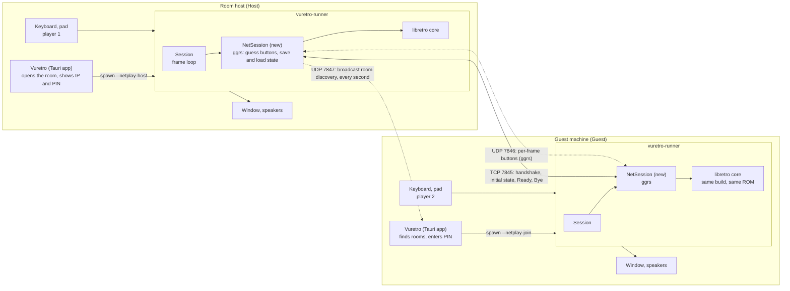
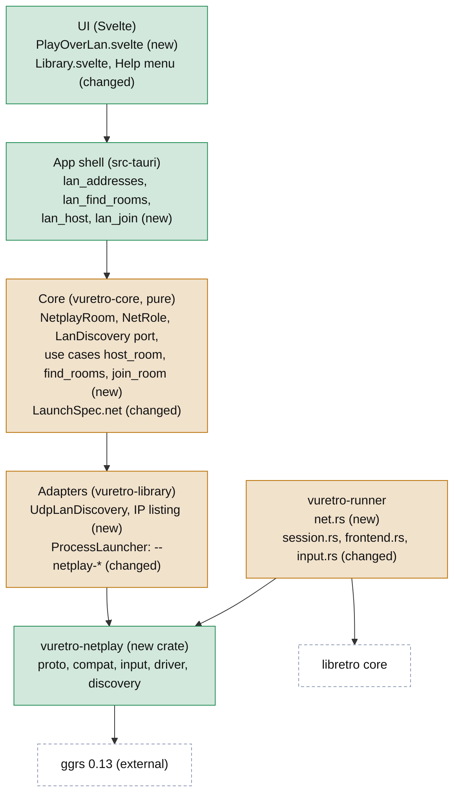
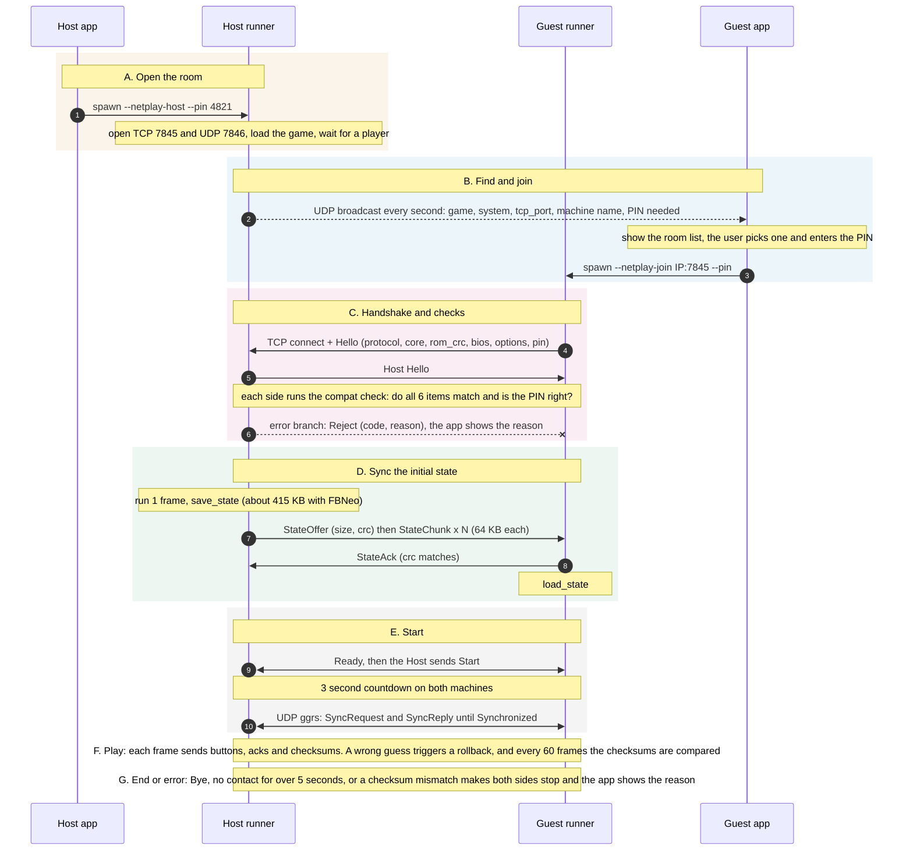
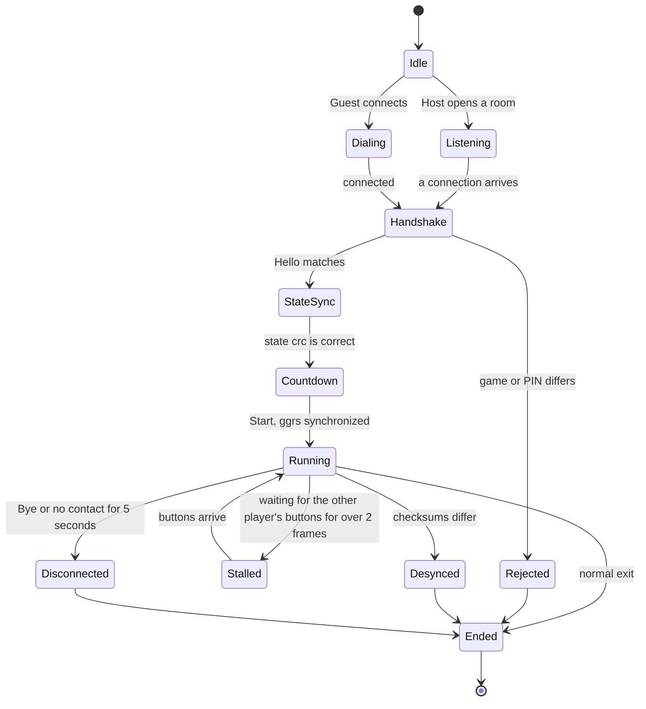
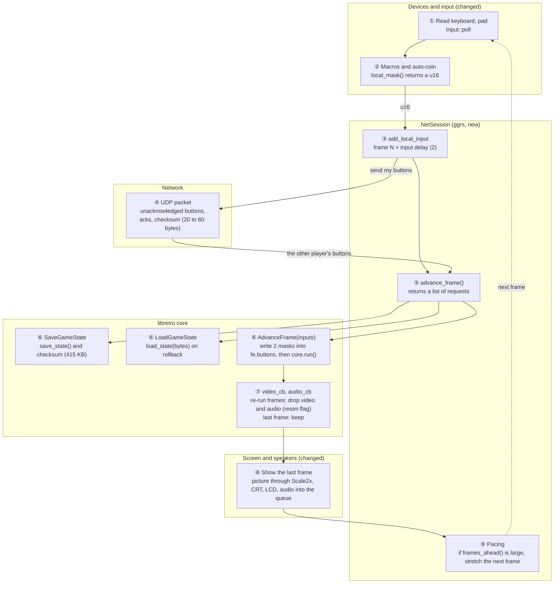
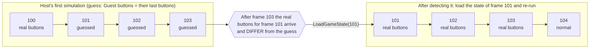
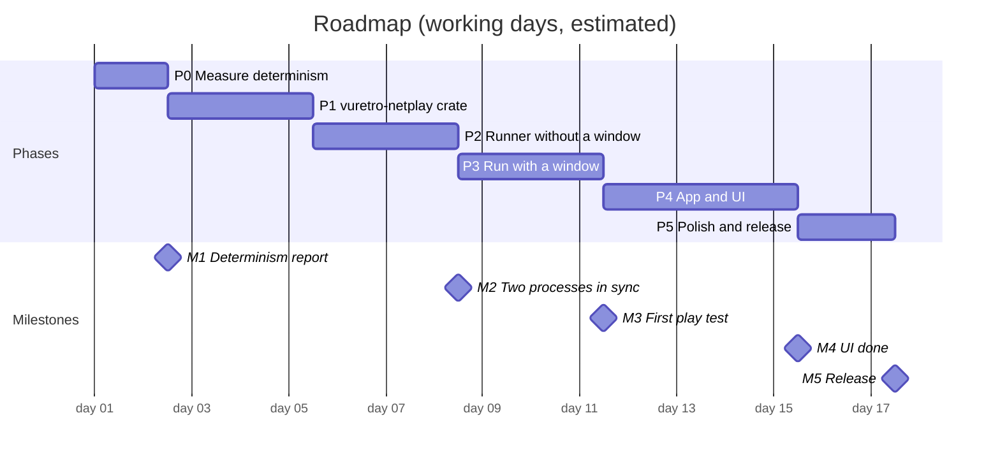
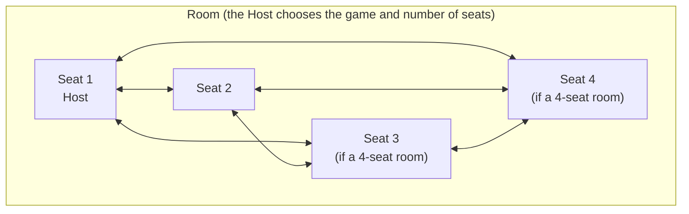
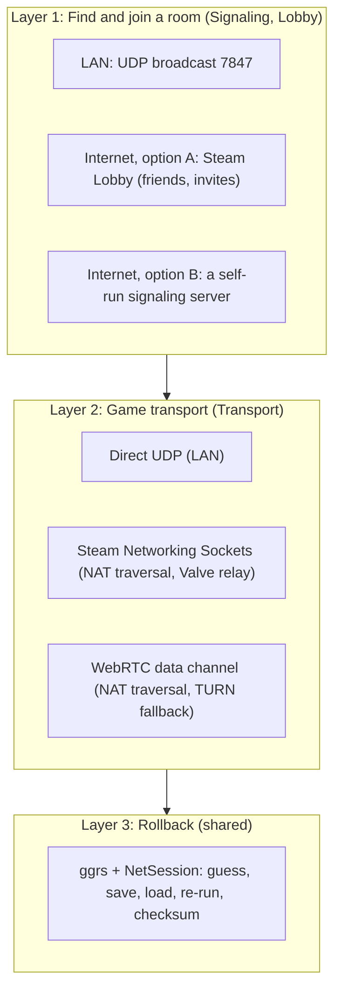

# Plan: playing together on two or more machines (netplay)

Status: **plan only, no code yet**.

Two machines on the same LAN play the same game, each player with their own pad or keyboard. Each machine runs the game itself and only the button presses cross the network. When the guess about the other player's buttons turns out wrong, the machine loads an older state and re-runs a few frames (rollback).

## Contents

1. [Summary and decisions](#1-summary-and-decisions)
2. [Big picture](#2-big-picture)
3. [Layered architecture](#3-layered-architecture)
4. [Connection flow](#4-connection-flow)
5. [Session state machine](#5-session-state-machine)
6. [Data flow of one frame](#6-data-flow-of-one-frame)
7. [Rollback](#7-rollback)
8. [Determinism](#8-determinism)
9. [Protocol](#9-protocol)
10. [Hotkey policy during network play](#10-hotkey-policy-during-network-play)
11. [Step-by-step plan](#11-step-by-step-plan)
12. [Test strategy](#12-test-strategy)
13. [Risks](#13-risks)
14. [Alternatives considered](#14-alternatives-considered)
15. [Decisions needed](#15-decisions-needed)
16. [Rooms of 2 to 4 machines](#16-rooms-of-2-to-4-machines)
17. [Internet and the transport layer](#17-internet-and-the-transport-layer)
18. [Status of reference projects](#18-status-of-reference-projects)

## 1. Summary and decisions

| | |
|---|---|
| **Approach** | Rollback netplay (GGPO style). Both machines run the same game from the same starting state. Every frame each machine sends its own buttons and guesses the other player's buttons by repeating their last ones. When the real buttons arrive and differ from the guess, the machine loads the saved state and re-runs the frames. |
| **Library** | [`ggrs`](https://crates.io/crates/ggrs) 0.13.0 (MIT or Apache-2.0, updated 06/2026). See [section 18](#18-status-of-reference-projects): a later lookup only found 0.12.0, so confirm on crates.io. |
| **Data on the wire** | 2 bytes per player per frame (the 16 libretro joypad buttons). At 60 frames per second, including re-sending buttons that are not yet acknowledged, that is a few KB per second. |
| **Measured on this machine** | An FBNeo (Neo Geo) state is about 415 KB. The core runs 1174 frames per second in a debug build, so re-running 8 frames takes about 7 ms (one frame is 16.7 ms). |
| **Input delay** | 1 to 2 frames on a LAN (ping under 2 ms), with almost no rollbacks. |
| **Long-term goal** | A **room** of 2 to 4 machines playing one game, on a LAN and over the Internet (see [section 16](#16-rooms-of-2-to-4-machines) and [section 17](#17-internet-and-the-transport-layer)). |
| **Scope of v1** | A 2-player room on a LAN, for 2D cores that pass the determinism check (expected: Neo Geo, SNES, NES, Genesis, GBA). The design leaves room for 4 players and the Internet. |
| **Out of scope for v1** | Internet and NAT traversal, 3 to 4 players (phases P6 and P7), spectators, joining mid-game, 3D systems and PS1, and pause, rewind, fast-forward and loading a state during network play. |
| **Estimate** | About 16 working days for one developer (a guess, not verified). |

## 2. Big picture

Each machine runs two processes: the Vuretro app (the UI) and `vuretro-runner`, which runs the game. Three paths cross the network, each with one job.



Each machine runs its own copy of the game. Only button presses cross the network. Video and audio never leave the machine.

## 3. Layered architecture

This follows the project's existing rules: rules and use cases live in `vuretro-core` behind ports, adapters live in `vuretro-library`, and networking and rollback live in a new crate so they can be tested on their own. `vuretro-core` does **not** depend on `ggrs` or on sockets (the existing architecture test stays as it is).



Legend: green is new code, orange is changed code, dashed is external.

### Files to add or change

| File | | Work |
|---|---|---|
| `crates/netplay/src/proto.rs` | new | Control messages (Hello, Accept, Reject, StateOffer, StateChunk, StateAck, Ready, Start, Bye), protocol version, length-prefixed encoding. |
| `crates/netplay/src/compat.rs` | new | Compare two Hellos: protocol, core, core version, ROM hash, BIOS hash, core-options hash. Returns a human-readable reason. |
| `crates/netplay/src/input.rs` | new | Convert the 16 button bools to `u16` and back. Port mapping: Host = 0, Guest = 1. |
| `crates/netplay/src/driver.rs` | new | `trait Sim` (save, load, advance) and `RollbackDriver` wrapping ggrs P2P and SyncTest. Checksums. Events (synchronized, desynced, disconnected). |
| `crates/netplay/src/discovery.rs` | new | Encode and decode the "VURETRO-LAN/1" packet, filter for stray packets. |
| `crates/runner/src/net.rs` | new | Bridge: implements `Sim` for the core, TCP handshake, initial state transfer, drives the rollback loop, mutes video and audio while re-running. |
| `crates/runner/src/session.rs` | changed | `run_core()` branches to `net.step()`. Filter for actions that are forbidden during network play. |
| `crates/runner/src/frontend.rs` | changed | `resim` flag: when set, `audio_batch_cb` drops audio and `video_cb` does not change the picture format. |
| `crates/runner/src/input.rs` | changed | Split out `local_mask()` (after macros and auto-coin) to send. Receive masks from the network and write them into `fe.buttons` before each `run()`. |
| `crates/core/src/{ports,service,model}.rs` | changed | `LaunchSpec.net`, `LanDiscovery` port, `NetplayRoom` model, use cases `host_room`, `find_rooms`, `join_room` with tests against fakes. |
| `crates/library/src/adapters/…` | new | `UdpLanDiscovery`, local IP listing, command-line arguments in `ProcessLauncher`. |
| `src-tauri/src/commands/lan.rs`, `ui/…/PlayOverLan.svelte` | new | Four Tauri commands and the Host and Join dialogs, with clear error messages. |

## 4. Connection flow

TCP carries everything that must be reliable (handshake, initial state). UDP carries the per-frame data.



The app only has to find rooms and launch the runner. The runner handles everything else on the network, so a network error never crashes the UI.

## 5. Session state machine



- **Rejected** only happens before the game runs, so nobody loses any data.
- **Stalled** is not an error: ggrs makes the faster machine wait for the slower one, the picture pauses for a beat and then continues.
- **Desynced** and **Disconnected** stop both sides. We do not try to "repair" a diverged state, because that would hide the bug.
- What the user sees: the window title `LAN · 1 ms · back 0/8` (ping, frames currently rolled back). While Stalled there is a "waiting for the other player…" line. At the end a dialog explains the reason and suggests a fix (check the ROM, check the firewall).

## 6. Data flow of one frame

This runs 60 times a second on each machine. Steps ① to ⑨ are the order of execution.



Without a rollback there is one `AdvanceFrame` per frame. With a rollback there is one `LoadGameState` followed by several `AdvanceFrame` calls in a row, and the player only sees the final frame.

### The loop as pseudo-code

```rust
// NetSession::step(): called once per frame, replaces the normal core run
let mask = input.local_mask();                 // ①② local buttons, after macros and auto-coin (u16)
session.add_local_input(local_handle, mask)?;  // ③ ggrs remembers the buttons for frame N + delay
session.poll_remote_clients();                 // ④ receive and send UDP

for request in session.advance_frame()? {      // ⑤
    match request {
        SaveGameState { cell, frame } => {
            let bytes = emu.save_state()?;     // ⑥ reuse the buffer, no allocation per frame
            cell.save(frame, Some(bytes), Some(checksum(&bytes)));
        }
        LoadGameState { cell, .. } => {
            fe.resim = true;                   // start re-simulating: mute video and audio
            emu.load_state(&cell.load())?;
        }
        AdvanceFrame { inputs } => {
            fe.buttons = to_buttons(inputs);   // [u16; 2] becomes bool[2][16], ports 0 and 1
            emu.run();                         // ⑦ video_cb, audio_cb run inside
        }
    }
}
fe.resim = false;
present_last_frame_and_audio();                // ⑧
pace(frames_ahead_adjusted_frame_time());      // ⑨
```

## 7. Rollback

Example: the Guest presses a button on frame 101, but the packet reaches the Host a few frames late.



- Three re-run frames fit inside one 16.7 ms beat and cost about 3 × 0.9 ms.
- Frames 101 to 103 were already shown using the guess and are not redrawn. The difference (the character did not jump right away) is corrected from frame 104.
- Prediction is limited to 8 frames. Beyond that ggrs stops the faster machine (Stalled). On a LAN this is almost never reached.
- An input delay of 1 to 2 frames lets most of the other player's buttons arrive in time, so no rollback is needed. It can be adjusted in settings.
- Cost: saving 60 times a second with a 415 KB state is about 25 MB per second of memory copying, which is light. PS1 (about 4 MB) is 10 times heavier and is not part of v1.

## 8. Determinism

Rollback is only correct if the same starting state and the same buttons always give the same result on both machines. This is the project's biggest risk, so the first step is to **measure**, not to assume.

The two machines must match on:

1. Core build (hash of the library file) and version.
2. ROM (CRC32 and size).
3. Shared BIOS, for example `neogeo.zip` (hash).
4. Core options that affect emulation, for example `fbneo-neogeo-mode` (hash of the options set).
5. Starting state: the Host sends the state at frame 0 so the game's SRAM, real-time clock and random number generator are identical on both sides.
6. No cheats, no fast-forward, no loading a state while playing.

**The measuring tool in step P0**: `vuretro-runner --determinism-check` runs a game with a fixed fake button sequence (a seeded random generator) and performs two checks:

- **Reload:** save a state at frame k, run to frame 600, load the state again and re-run. Both runs must give the same video, audio and state hashes on every frame.
- **Two processes:** run two independent processes from the same starting conditions and compare hashes on every frame.

The result is a "core × ROM: pass or mismatch" table. Only passing pairs may enable netplay.

| System, core | Initial expectation | Reason and what to check |
|---|---|---|
| Neo Geo, arcade: FBNeo | Suitable | Full state (415 KB measured). Check that the BIOS mode and DIP switches are the same. |
| SNES: snes9x | Suitable | Classic, deterministic core. Be careful with speed-up options such as removing the sprite limit. |
| NES: fceumm. Genesis, SMS: Genesis Plus GX. PC Engine | Suitable | Light, small state. Verify each core with the P0 tool. |
| Game Boy Advance: mGBA | Needs checking | Some games read the real-time clock (RTC), which must be sent in the initial state or fixed. The link cable is not emulated. |
| PlayStation: PCSX ReARMed | Later | State is about 4 MB, so saving every frame costs 10 times more. Measure before deciding. |
| Arcade: MAME 2003-Plus, current MAME | Needs checking | Some games use several threads or real-time counters. |
| 3D systems (N64, PSP, GameCube, PS2, 3DS) | No | Multi-threaded cores, GPU rendering, very large states. Out of scope. |

## 9. Protocol

Control uses TCP (reliable, ordered). Per-frame data uses ggrs's UDP. Control messages are small, so they use length-prefixed JSON (easy to debug). Only the initial state uses a binary block.

| Port | Protocol | Content | Sender |
|---|---|---|---|
| `7845` | TCP | Control messages, initial state | both |
| `7846` | UDP | ggrs packets: buttons, acks, checksums, sync | both |
| `7847` | UDP broadcast | Room announcement "VURETRO-LAN/1" | Host, every second |

| Message (TCP) | Main fields | Purpose |
|---|---|---|
| `Hello` | `proto`, `app`, `core`, `core_hash`, `rom_crc`, `rom_size`, `bios_hash`, `options_hash`, `fps`, `pin` | Each side declares its configuration for comparison. |
| `Accept`, `Reject` | `code`, `reason` (human-readable) | Result of the comparison. The reason is shown to the user directly. |
| `StateOffer` | `size`, `crc32`, `chunks` | The Host announces the size of the initial state. |
| `StateChunk` | `seq`, bytes (64 KB) | Transfers the state block by block, and can report progress. |
| `StateAck` | `crc_ok` | The Guest confirms it loaded the state correctly. |
| `Ready`, `Start` | `countdown_ms` | When both are ready the Host starts the game. ggrs synchronizes the timing itself in the UDP phase. |
| `Bye` | `reason` | A deliberate exit, so the other side can show the right message. |

**Security for an open port on the LAN**

- A 4-digit PIN in Hello. Exactly one player is accepted and later connections are closed.
- Every packet has a size limit. Messages that are not recognized are dropped.
- Never run code or open files from a packet. Only read data with a fixed structure.
- Room discovery can be turned off in favor of typing the IP by hand.

**What to expect on each operating system**

- Windows and macOS may ask for firewall permission the first time a port is opened.
- macOS 15 and later asks for the "Local Network" permission when an app listens for broadcasts.
- Some Wi-Fi networks isolate each device. Broadcasts do not arrive there, so there is always an IP entry field.

## 10. Hotkey policy during network play

Rule: anything that changes the emulation is forbidden. Anything that only changes how things look on your own machine is kept.

| Feature | During network play | Reason |
|---|---|---|
| Pause, fast-forward, slow motion | Off | Changes one machine's emulation pace, so the two sides diverge at once. |
| Rewind, load state, resume where you stopped | Off | Moves the state into the past on only one machine. |
| Cheats, disc swap, reset | Off in v1 | They change memory. Could be added later as "ask both sides". |
| Save state (F5) | Allowed | Only writes to a file, does not change the emulation. |
| Screenshot, mute, window resize, fullscreen | Allowed | Only affects the display on your own machine. |
| CRT, LCD, Scale2x | Allowed | Effects applied to the already-drawn picture, never touching the core. |
| Macros and auto-coin | Allowed | They run before the mask to send is built, so the other side receives the final result. |
| Quit the game | Ends the session | The other side receives Bye and sees the reason. |

Auto-coin counts polls, one per frame, and polling happens only once per real frame (it is not repeated during a rollback), so it stays deterministic.

## 11. Step-by-step plan

Six phases, each with something you can check and a completion criterion. Do them in order. The numbers of days are estimates for one developer.



### P0. Measure determinism (1.5 days)

Addresses the risk: a core is not deterministic.

- Add a `--determinism-check` flag to the runner: runs headless, a fake button sequence from a fixed random generator, and records video, audio and state hashes on every frame.
- Two modes: reload a state and re-run, and run in two separate processes.
- Run on the real ROMs available for FBNeo, snes9x, mGBA, Genesis Plus GX and fceumm.

**Done when:** there is a "core × ROM: pass or mismatch" table, the list of systems allowed to enable netplay in v1 is settled, and the project's test core passes 100% (turned into an automatic check in CI).

### P1. The `vuretro-netplay` crate (3 days, after P0)

- A pure crate (no direct I/O): `proto`, `compat`, `input` and the `discovery` codec.
- `trait Sim` and `RollbackDriver` wrapping ggrs. Use ggrs's **SyncTestSession** to force a rollback every frame on a "fake simulation" and compare checksums.
- A reused state buffer, with no allocation per frame.
- Pin the ggrs version and record the version that was verified.

**Done when:** unit tests cover every message and every compat branch, SyncTest over 10,000 frames on the fake simulation does not diverge, and fuzzing the packet decoder does not panic.

### P2. The runner works without a window (3 days, after P1)

- Flags `--netplay-host`, `--netplay-join`, `--pin` and `--net-delay`.
- TCP handshake, initial state transfer, ggrs over real UDP, and the `resim` flag in the frontend.
- Wrap the socket so tests can inject packet loss, delay and reordering.

**Done when:** an automatic test runs two runner processes on localhost with the test core for 3000 frames, the final state hashes of both sides are equal on all three operating systems in CI, and it still passes with 10% packet loss and 0 to 40 ms of random delay.

### P3. Run with a window (3 days, after P2)

- Hook into `Session::run_core`: pace by `frames_ahead()`, show only the last frame, and mute audio during re-runs.
- Hotkey filter following the policy table. Show ping and the number of rolled-back frames in the title.
- Handle pad unplugged, window closed, network lost and Stalled.

**Done when:** two real machines play Neo Geo over a LAN for 10 minutes without diverging, there is no odd sound during rollbacks, and it has been tried on macOS, Windows and Linux.

### P4. App and UI (4 days, after P3)

- Core: `NetplayRoom` model, `LanDiscovery` port, use cases `host_room`, `find_rooms` and `join_room` with tests against fakes.
- UDP broadcast adapter and IP listing. Tauri commands. A Host dialog (shows IP and PIN) and a Join dialog (room list and an IP field).
- Clear errors (different ROM, wrong PIN, firewall). An item in the Help menu and a button on the game detail. USAGE documentation.

**Done when:** two people who have not read the documentation can join a room in under a minute, and every error message tells them what to do.

### P5. Polish and release (2 days, after P4)

- Try on Wi-Fi and Ethernet, and set the default input delay from the measurements.
- A mode that dumps the state on divergence (`--net-dump-on-desync`) to investigate user-reported bugs.
- Add entries to CHANGELOG and USAGE, add a "Play over LAN" section to the guide, and release.

**Done when:** the list of supported systems is written down clearly, there is a troubleshooting guide, and the release has notes on the limitations.

## 12. Test strategy

From cheap to expensive:

1. **Unit:** message encoding, compat comparison, button mapping, the broadcast packet (runs in milliseconds).
2. **SyncTest:** force a rollback every frame, and every checksum must match (catches save and load state bugs).
3. **Two processes on localhost:** test core, compare the final state hash, run in CI on 3 operating systems.
4. **Network fault injection:** packet loss of 0, 5, 10 and 20%, delay of 0 to 40 ms, and reordering.
5. **Matrix of real cores:** the cores and ROMs that passed P0, run overnight or by hand.
6. **Manual on a real LAN:** a checklist for Wi-Fi, Ethernet and firewalls.

Bugs that must have a test guarding against them:

- A desync must not be hidden: it must stop and report.
- A macro or auto-coin press must not be sent twice during a rollback.
- Audio and video of re-run frames must not leak out.
- A stray or oversized packet must not crash the runner.
- Architecture test: `vuretro-core` does not depend on ggrs or sockets.

## 13. Risks

| Risk | Level | Mitigation |
|---|---|---|
| A core is not deterministic (real clock, multi-threading) and the two machines drift apart | High | Measure first in P0. Enable netplay only for passing core and ROM pairs. Send the initial state. Check checksums periodically to stop as soon as they diverge. |
| Jittery Wi-Fi makes rollbacks long | Medium | Input delay of 2 to 3 frames, maximum prediction of 8, show the ping, and recommend Ethernet for fighting games. |
| Firewall, Local Network permission, device-isolating Wi-Fi | Medium | Clear message about the cause and how to open it. Always provide a manual IP field. |
| Audio breaks up during rollbacks | Medium | The `resim` flag drops audio from re-run frames. Only the last frame's audio is pushed. |
| A large state (PS1) costs too much CPU | Medium | Allow-list, measure in P0, reused buffers. |
| The two machines have different core versions or options without knowing | Medium | Hashes in Hello, and Reject with a human-readable reason. |
| An open port on the LAN is joined by someone else | Medium | PIN, accept one player, packet size limits. |
| Dependence on `ggrs` (externally maintained) | Low | Wrap it behind `RollbackDriver`. MIT or Apache-2.0 license. Updated 06/2026. |

## 14. Alternatives considered

| Option | Pros | Cons | Verdict |
|---|---|---|---|
| **Rollback with ggrs** | Feels almost like playing side by side. A proven library. Reuses the existing save and load state. | Needs a deterministic core. A measuring tool must be built. | **Chosen** |
| Lockstep with a fixed delay | Simple and easy to understand | Delay equals the whole ping. One slow packet freezes the picture. | Fallback if ggrs gives trouble |
| Video streaming (Parsec, Moonlight, Steam Remote Play) | No code to write. Works for 3D systems too. | Adds 10 to 30 ms. Not integrated into the app. | The way to play today |
| Write rollback from scratch | Full control | Many weeks, subtle bugs, no better than ggrs | Rejected |
| Compatibility with RetroArch's netplay protocol | Play with RetroArch users | Must match each core version and the protocol. A large job. | Rejected for v1 |
| WebRTC (matchbox) for the Internet | NAT traversal, no need to open ports | Needs a signaling server to operate | A later phase, on the same `RollbackDriver` |

## 15. Decisions needed

1. **Start with P0?** P0 takes 1.5 days and shows right away which cores are usable. Recommended: do it first, and only then commit to the later phases.
2. **Default PIN?** Recommended: PIN on by default with 4 digits, with an option to turn it off in settings (home LANs and cafés often have strangers).
3. **Number of players.** The goal is a room of 2 or 4 machines ([section 16](#16-rooms-of-2-to-4-machines)). Recommended: v1 supports two players, but write the code for any number of players from the start, so four players is only testing and UI work.
4. **Internet.** It is in the plan as a later phase ([section 17](#17-internet-and-the-transport-layer)). A choice is needed between Steam and WebRTC with a self-run signaling server. Recommended: decide after the measurements from P0 and P2.
5. **Is Steam needed?** Only if Steam is chosen for the Internet (it needs an AppID and users must install Steam). A LAN does not need it.

## 16. Rooms of 2 to 4 machines

A **room** is the unit the user sees: the Host opens a room for one game and chooses the number of seats, others join, and then everyone starts at the same time.



Every pair of machines connects directly (a full mesh): 2 machines have 1 link, 4 machines have 6 links. ggrs supports multiple players in this model, with each player controlling one port of the core.

**Rules**

- A room has 2 or 4 seats. Offer 4 only when the game really has four or more controller ports (see the table below). Otherwise the UI only offers 2.
- Seats can be left empty: a 4-seat room can still start when the Host presses Start, but in v1 the number of players must equal the number of seats chosen (a simplification, empty ports can come later).
- Everyone receives **the same initial state** from the Host (the mechanism in section 4, phase D, extended to N players: the Host sends to each player, each replies with `StateAck`, and only when all are done does the Host send `Start`).
- All machines in the room must pass the same `compat` check as the Host (section 8). Anyone who differs is removed from the room with a reason.
- If someone loses connection during play: v1 ends the whole session (simple, and it cannot leave the state diverged). Later the rest could be allowed to continue with that port left empty.
- Joining mid-game: not supported in v1. It could be added later by sending the current state at a sync point.

**Which games can have four players**

| System | Most games | Four players needs |
|---|---|---|
| Neo Geo | 2 players | Not available (only a 2-seat room). |
| SNES | 1 to 2 | A multitap and a game that supports it (for example Super Bomberman). |
| NES | 1 to 2 | A Four Score or Satellite and a game that supports it. |
| Genesis, Master System | 1 to 2 | A multitap (EA 4-Way Play, Team Player) and a game that supports it. |
| Arcade (CPS1, CPS2 and MAME) | 2 to 4 | Beat 'em up games with 3 to 4 players such as Cadillacs and Dinosaurs (3 players), Knights of the Round, X-Men (depending on the version). |
| Game Boy, GBA | 1 | The link cable is not emulated, so not available. |

This list is general knowledge and has not been verified core by core in Vuretro. The real number of ports will come from the core (`retro_set_controller_port_device` and the port information) and from the systems table in the `systems.json` data, and then be checked with P0 and by trying it.

**Code changes compared with the two-player plan**

- `Hello`, `StateOffer`: add `slot` (the sender's seat) and `players` (the number of seats in the room).
- `RollbackDriver`: create ggrs with `num_players = N`. Map seats to core ports (seat 1 is port 0, and so on). `fe.buttons` must hold all N ports.
- Host UI: choose the number of seats (2 or 4), a list of who has joined, and a Start button that is only enabled when everyone is in and every `StateAck` has arrived.
- Network cost: each machine sends its buttons to N-1 machines. With 4 machines it is still only a few KB per second per link.
- Input delay and prediction: ggrs uses one delay for the whole room. The weakest link decides the overall smoothness, so on bad Wi-Fi a 4-player room will stutter more visibly than a 2-player room.

## 17. Internet and the transport layer

So that a LAN and the Internet share the same rollback code, split the design into three layers, each replaceable independently:



- Layer 3 knows nothing about the transport. It only sends and receives packets through a `Transport` interface (with ggrs this is the `NonBlockingSocket` trait).
- Layer 1 returns the room list and the information needed to connect (address, room code).
- Layer 2 handles the real connection between each pair of machines, including NAT traversal.

**Two options for the Internet**

| | Steam (Lobby, Sockets, Relay) | WebRTC and a self-run signaling server |
|---|---|---|
| NAT traversal, relay | Built in (Valve's relay) | Yes (STUN). A relay needs TURN and your own operation. |
| Finding friends, invites | Steam friends list, Lobby | Room code or link, built by us |
| Operation | Almost none | Must run and pay for a small server |
| Constraints | Needs a Steam AppID (a real release needs a registered app, under Valve's terms). Users must have Steam installed. | Not tied to any platform |
| Latency | A direct path if NAT traversal works. Through the relay it adds a few ms. | Similar |
| Risk | Depends on Valve. I have not rechecked the release conditions. | You own the operation and security |

The direction is not chosen yet. A LAN needs nothing in layers 2 and 3 beyond direct UDP, so it is built first. The Internet decision comes after real measurements.

**Internet specifics to plan for**

- With a ping of 30 to 150 ms, rollbacks happen often. The CPU cost of long re-runs needs measuring (see section 7), and the input delay could be raised automatically with the ping.
- A 4-player room over the Internet needs NAT traversal for 3 links per machine. One broken link affects the whole room, so the quality of each link must be shown.
- IP addresses are exposed to people in the room. A relay or a room code can reduce this, and it must be stated clearly to users.
- Security: a PIN or a short-lived invite code, packet size limits, and never trusting data from another machine.

### Two problems specific to the Internet

1. **NAT traversal.** A machine at home sits behind a router and has no public address. The two machines must "punch a hole" (hole punching) with help from a signaling server and STUN. Some kinds of NAT (and carrier-grade NAT, CGNAT) make hole punching fail. In that case traffic has to go around through a relay (TURN or Steam's relay). There are no figures yet on how often it fails, so this needs measuring in real tests.
2. **Real ping.** A ping of 30 to 150 ms makes rollbacks run often. Estimated thresholds (a guess, not measured):

| One-way ping to the other player | Expected feel |
|---|---|
| under about 60 ms | Plays well |
| about 60 to 100 ms | Playable, with slight stutter during rollbacks |
| over about 120 ms | No longer comfortable for fighting games |

The prediction limit of 8 frames is about 133 ms. Beyond it the faster machine has to wait (Stalled). The UI must show the ping of each link and warn when a threshold is crossed, so players know whom to invite.

**Relay cost is low:** game traffic is only a few KB per second per link. The only heavy part is the initial state (about 415 KB with FBNeo), sent once. So running a relay does not use much bandwidth, and the main cost is the effort of operating it.

### Three options for the Internet

| | Pros | Cons |
|---|---|---|
| **WebRTC with the matchbox library** | Built to work with ggrs. NAT traversal, and a TURN server can be plugged in as a relay. Not tied to a platform. | You must run a small signaling server (and TURN if you want a relay). I have not checked the library's current maintenance status. |
| **Steam** (Lobby, Sockets, Relay) | Almost nothing to operate. Friends and invites already exist. | Needs an AppID and users must install Steam. Depends on Valve. |
| **Open a port yourself, type an IP** | No server needed | Hard to use. Many networks (CGNAT) cannot open ports. |

**Recommendation:** WebRTC with matchbox, because it is not tied to a platform and is aimed squarely at ggrs. Steam is the alternative if putting Vuretro on Steam is acceptable. Both plug into the `Transport` layer above, so choosing later does not mean redoing the rollback part.

**Precondition before starting the Internet work:** the LAN (P0 to P3) must run well, because determinism bugs show up much harder on the Internet.

**Decisions needed:** (a) are you willing to run a signaling server (and maybe a relay)? If not, choose Steam. (b) the maximum ping accepted for a room (invite only nearby people, or far away ones too).

**Additional phases**

| Phase | Content | Estimate (a guess) |
|---|---|---|
| P6. 4-player rooms | Generalize the protocol and UI to N players, test with a fake 4-process setup on localhost, and try one real 4-player game | about 3 days |
| P7. Internet | The `Transport` and `Lobby` interfaces, one option (Steam or WebRTC), NAT traversal, a link quality indicator, and trying it on a real network | about 8 to 12 days, depending on the option chosen |

These two phases come after P5. P6 can come right after P3 if you want four players on a LAN sooner.

## 18. Status of reference projects

Web lookup (November 2026). The sources are secondary and sometimes contradict each other, so **check the official pages before relying on any of this**.

| Project | What was found | Confidence |
|---|---|---|
| **Fightcade** | The Flathub package describes its emulator as FightcadeFBNeo, based on FBNeo 0.2.97.44 with a customized GGPO build, still the current way to play rollback peer to peer (P2P). The package is only a community repackaging, not an official release. No official announcement or changelog for 2026 was found. | Medium. Check fightcade.com. |
| **RetroArch** | A secondary source says the stable release is 1.22.2 (from November 2025). GGPO-style rollback has existed for a long time, but only works with cores that support serialization (save state) and costs CPU. Both sides need the same core build. No 2026 release notes specifically about netplay were found. | Low to medium. Check retroarch.com and the Libretro forums. |
| **Slippi** (Dolphin) | Rollback lives in Slippi's own fork (based on Ishiiruka), not in mainline Dolphin, whose netplay is the waiting kind. The version numbers of the launcher and the Ishiiruka fork contradict each other between sources (for example launcher 2.10.5, 2.11.8, 2.13.1). | Low. Check the project-slippi GitHub. |
| **ggrs and matchbox_socket** | The lookup found ggrs 0.12.0 as the newest (its README calls it fairly stable), while matchbox_socket 0.14.0 declares a dependency on ggrs 0.11 through its optional `ggrs` feature. There is a fork called Fortress Rollback. | Medium. **Mismatch with section 1:** this document states ggrs 0.13.0 (from an earlier lookup), so confirm on crates.io. |

**Consequences for the plan**

- **Check the ggrs version.** The ggrs version that matchbox supports may be older than the ggrs we want to use. If the two disagree, do not use matchbox's `ggrs` feature. Write an adapter from the WebRTC socket to ggrs's `NonBlockingSocket` trait instead (little code, contained in the `Transport` layer from section 17).
- **Pin the ggrs version in step P1** and record the version that was verified, since it is the main dependency of the rollback part.
- What was found about Fightcade and RetroArch also confirms what section 8 says: enable netplay only for core and ROM pairs that passed the determinism check, and both sides must use the same core build.

Sources used: [Flathub, Fightcade](https://flathub.org/en/apps/com.fightcade.Fightcade), [RetroArch netplay guide (Retro Handheld HQ)](https://retrohandheldhq.com/posts/retroarch-netplay-guide/), [matchbox_socket 0.14.0 on docs.rs](https://docs.rs/crate/matchbox_socket/0.14.0/source/Cargo.toml), [ggrs 0.12.0 on docs.rs](https://docs.rs/crate/ggrs/0.12.0/source/README.md), [Slippi on SSBWiki](https://ssbwiki.com/Slippi).

---

The figures "415 KB" and "1174 frames per second" were measured on the development machine with the FBNeo core and a Neo Geo game (debug build). The estimates of working days and latency are the planner's guesses and have not been verified. P0 and P2 will give real numbers.
