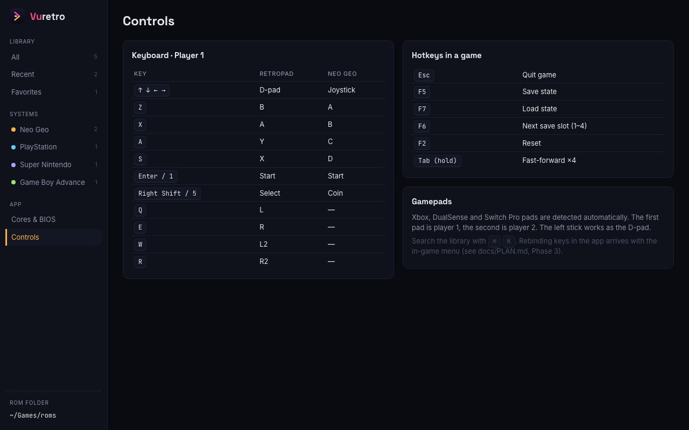

# UI

The app is built with Tauri v2 and Svelte (`ui/` for the frontend, `src-tauri/` for the Rust side). Start it with `make dev`.

> The screenshots below are the real UI rendered with **sample data** (made-up game names), so they can be regenerated without ROMs. Interactive design reference: https://claude.ai/artifact/TFnBEM1GyQF9oLw4edGJAn

## Style

- Dark background `#090B10`, surfaces `#0F121A` / `#131724`, border `#1C2130`
- Amber accent `#FFB347`, one color per system: Neo Geo amber, PlayStation cyan `#5AD1FF`, SNES purple `#B79CFF`, GBA green `#9BE36B`
- Brand: magenta `#FF4F8B` + amber play-button mark, see [docs/assets/brand](assets/brand/README.md)
- Fonts (bundled, work offline): Space Grotesk (headings), Inter (body), JetBrains Mono (files, keys), Press Start 2P (cover titles)
- CRT effect: scanlines on covers and the hero preview

## Screens

### Library

Sidebar (Library: All / Recent / Favorites; Systems with game counts; ROM folder) · search (`⌘K` on macOS, `Ctrl+K` elsewhere) · "Continue playing" hero · cover grid sorted by Recent / A–Z / Size · details panel with core, file, BIOS state, play time and favorite. **Play** is locked with a reason when the BIOS or core is missing. Double-click a cover to play.

First launch, before any ROM folder is chosen, shows a welcome screen with **Choose ROM folder** and, when the runner is built, **Try the demo** (the fake test core, no ROM needed).

### Cores & BIOS

One card per system (core, extensions, game count, BIOS) with a status (Ready / BIOS missing / Core missing / Off) and a switch. Drop BIOS files on the window, or click the drop zone to browse: vuretro verifies the MD5 (a renamed dump still works) and copies it into `<data dir>/system/`.

### Controls

Shows the keyboard layout, in-game hotkeys and gamepad behavior. Rebinding keys from the app is planned with the in-game menu (Phase 3).

## Notes for development

- `npm run dev` in a plain browser (without Tauri) serves mock data, which is how the screenshots are produced. Deep links for screenshots: `#cores`, `#controls`, `#select`.
- Hotkey hints follow the OS (`⌘` vs `Ctrl`).
