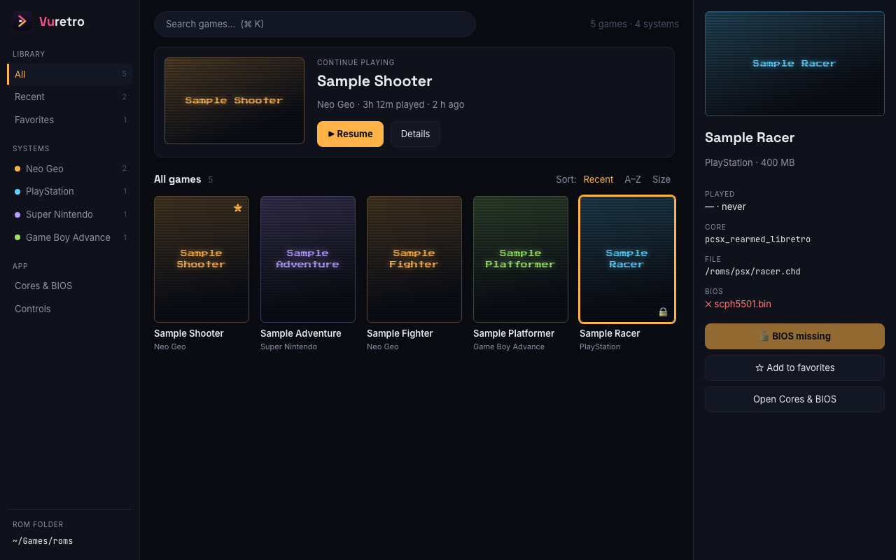
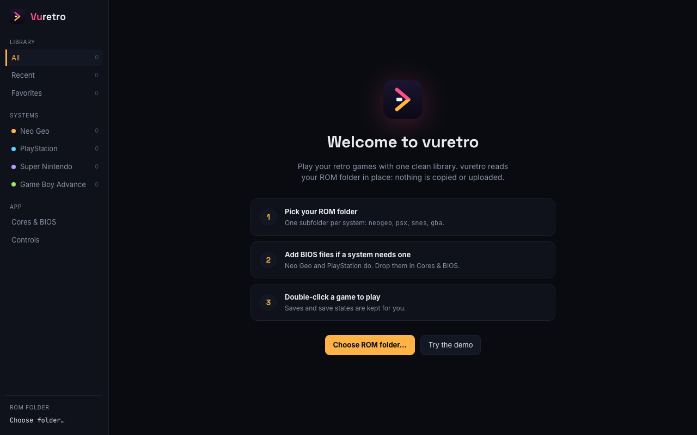
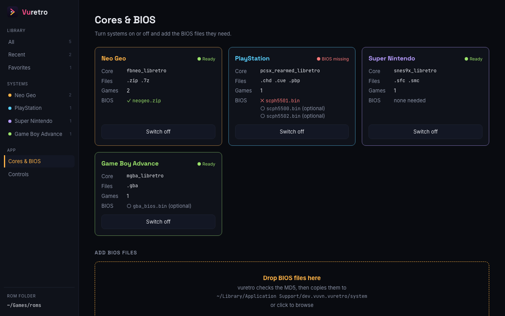

# UI

The app is built with Tauri v2 and Svelte (`ui/` for the frontend, `src-tauri/` for the Rust side). Start it with `make dev`.

> The screenshots below are the real UI rendered with **sample data** (made-up game names), so they can be regenerated without ROMs. Interactive design reference: https://claude.ai/artifact/TFnBEM1GyQF9oLw4edGJAn

## Style

- Dark background `#090B10`, surfaces `#0F121A` / `#131724`, border `#1C2130`
- Amber accent `#FFB347`, one color per system: Neo Geo amber, PlayStation cyan `#5AD1FF`, SNES purple `#B79CFF`, GBA green `#9BE36B`
- Brand: magenta `#FF4F8B` + amber play-button mark, see [docs/assets/brand](assets/brand/README.md)
- Fonts (bundled, work offline): Space Grotesk (headings), Inter (body), JetBrains Mono (files, keys), Press Start 2P (cover titles)
- CRT effect: scanlines on covers and the hero preview

## Screens

### Library

Sidebar (Library: All / Recent / Favorites; Systems with game counts; ROM folder) · search (`⌘K` on macOS, `Ctrl+K` elsewhere) · "Continue playing" hero · cover grid sorted by Recent / A–Z / Size · details panel with core, file, BIOS state, play time and favorite. **Play** is locked with a reason when the BIOS or core is missing. Double-click a cover to play.

First launch, before any ROM folder is chosen, shows a welcome screen with **Choose ROM folder** and, when the runner is built, **Try the demo** (the fake test core, no ROM needed).

### Cores & BIOS

One card per system (core, extensions, game count, BIOS) with a status (Ready / BIOS missing / Core missing / Off) and a switch. Drop BIOS files on the window, or click the drop zone to browse: vuretro verifies the MD5 (a renamed dump still works) and copies it into `<data dir>/system/`.

### Controls

Everything about input in one place, saved instantly to `<data dir>/config/controls.json` and applied the next time a game starts:

- **Players**: pick the device for Player 1 and Player 2 (Auto, keyboard only, a specific gamepad by name, or disabled) and **Swap** them with one click. Auto means keyboard + first gamepad for P1 and the next free gamepad for P2. A pad chosen by name keeps its player even if the connection order changes.
- **Connected gamepads**: live list; press a button on a pad and its row lights up, so you know which one is which.
- **Button mapping**: per player, every RetroPad button can have several keys and several gamepad buttons. Click **+ Set** / **+ Add**, then press the key or pad button. A key or button belongs to one action per player. Esc cancels. Reset restores the defaults.
- **Stick**: dead zone slider and a switch for using the left stick as the D-pad.
- Reserved keys (Esc, Tab, F2, F5, F6, F7) are runner hotkeys and cannot be bound.

## Notes for development

- `npm run dev` in a plain browser (without Tauri) serves mock data, which is how the screenshots are produced. Deep links for screenshots: `#cores`, `#controls`, `#select`.
- Hotkey hints follow the OS (`⌘` vs `Ctrl`).
