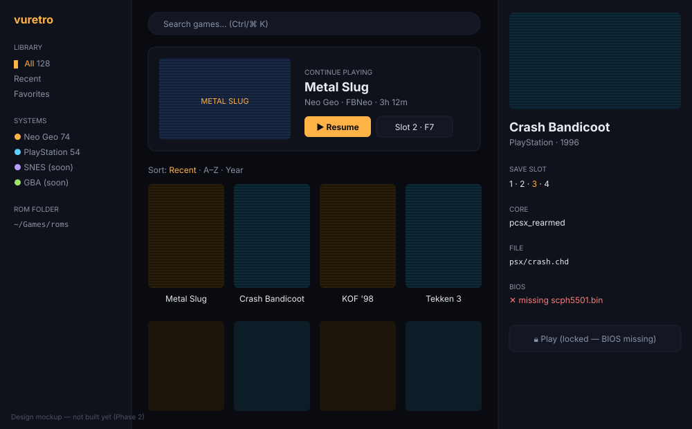
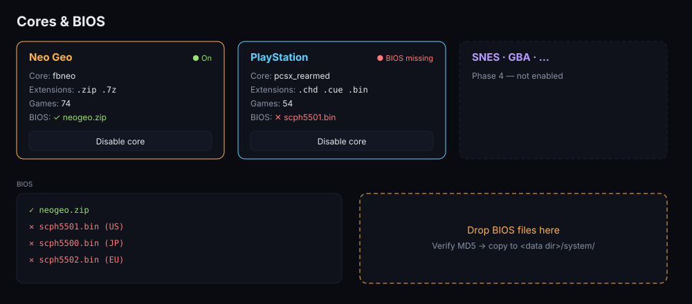
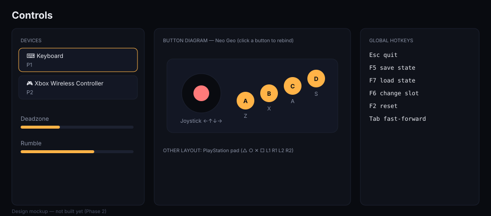

# UI design

> The images below are **design mockups** (SVG in [docs/images/](images/)). The Tauri UI is not built yet (Phase 2 in [PLAN.md](PLAN.md)).
> Interactive version: https://claude.ai/artifact/TFnBEM1GyQF9oLw4edGJAn

## Style

- Dark background `#090B10`, surfaces `#0F121A` / `#131724`, border `#1C2130`
- Amber accent `#FFB347` (configurable), one color per system: Neo Geo amber, PlayStation cyan `#5AD1FF`, SNES purple `#B79CFF`, GBA green `#9BE36B`
- Fonts: Space Grotesk (headings), Inter (body), JetBrains Mono (file names, keys), Press Start 2P (pixel accents)
- CRT effect: `repeating-linear-gradient` scanlines on covers and the preview screen

## Screens

### Library

Sidebar (Library: All / Recent / Favorites; Systems with game counts; ROM folder chip) · search bar · "Continue playing" hero (CRT preview, play time, save slot) · cover grid sortable by Recent / A–Z / Year · details panel (save slots, core, file, BIOS, Play button locked when BIOS is missing).

### Cores & BIOS

One card per system (core, file extensions, on/off, status, game count, BIOS) · list of BIOS files present / missing · BIOS drop zone (verify MD5, then copy into `system/`).

### Controls

Devices (keyboard, gamepads, P1/P2 assignment, deadzone, rumble) · per-system button diagram (Neo Geo arcade cabinet, PlayStation pad) click to rebind · key binding table · global hotkeys.

Default keyboard layout used by the runner today:

## To adjust when building for real (cross-platform)

- Drop macOS-only details from the mock: "Renderer: Metal", the "arm64" label, `⌘K` / `⌘F`
- Show hotkeys per OS: `⌘` on macOS, `Ctrl` on Windows/Linux
- BIOS paths come from each OS's data dir (see [ARCHITECTURE.md](ARCHITECTURE.md#data-directory))
